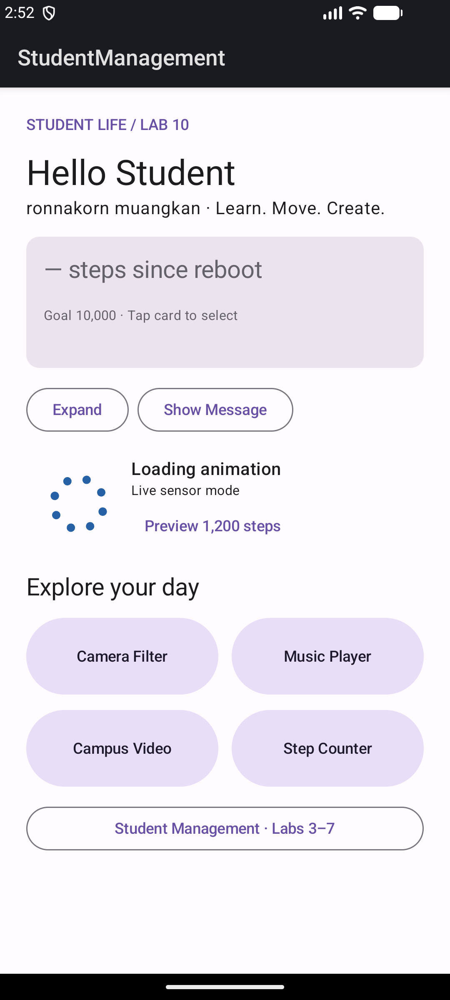
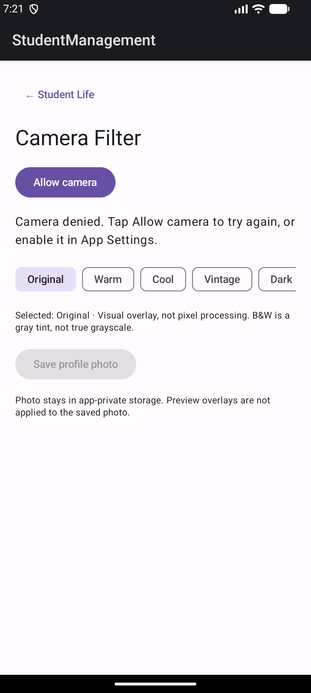

# Lab 10 — Multimedia and Sensors

ผู้จัดทำ: **ronnakorn muangkan**  
วันที่ตรวจโค้ดและจัดชุดส่ง: **24 ตุลาคม 2026**  
โปรเจกต์: Student Life ใน StudentManagement เดิม

## 1. งานที่ทำตามใบงาน

ใบงาน Lab 10 มีฟีเจอร์ Multimedia เดียวกับที่พัฒนาไว้ใน Lab 8 จึงใช้ implementation เดิมต่อโดยไม่สร้าง Android Project ใหม่ ตรวจตามขั้นตอนทั้ง 21 ขั้น และเปลี่ยนหัวข้อ Home เป็น LAB 10 ส่วน Animation จาก Lab 9 และระบบ Login/ฐานข้อมูลจาก Lab 3–7 ยังคงใช้ร่วมกันได้

| ขั้นในใบงาน | สิ่งที่มีในงานส่ง | ไฟล์/ตำแหน่ง |
| --- | --- | --- |
| 1–2 โปรเจกต์เดิมและ package | เพิ่มฟีเจอร์ใต้ Presentation ตามโครงสร้างเดิม | presentation/ui/{home,camera,music,video,sensor} |
| 3 CameraX | camera-camera2, camera-lifecycle, camera-view เวอร์ชัน 1.4.2 เท่ากัน | app/build.gradle.kts |
| 4 CAMERA permission | ประกาศใน Manifest | app/src/main/AndroidManifest.xml |
| 5–7 Preview และ runtime permission | AndroidView → PreviewView → CameraX, bindToLifecycle, ขอสิทธิ์ก่อนเปิด | CameraScreen.kt |
| 8–9 Filter | Original, Warm, Cool, Vintage, Dark, B&W | CameraScreen.kt |
| 10–13 Music | music.mp3, MediaPlayer, Play/Pause/Stop, release | MusicScreen.kt |
| 14–16 Video | campus.mp4, VideoView, MediaController, AndroidView | VideoScreen.kt |
| 17–18 Sensor และ permission | ACTIVITY_RECOGNITION, TYPE_STEP_COUNTER, SensorEventListener | StepCounterManager.kt และ Manifest |
| 19 เป้าหมายก้าว | เป้าหมาย 10,000 และ LinearProgressIndicator | StepCounterScreen.kt, StepProgress.kt |
| 20–21 Home และ Navigation | home → camera/music/video/sensor พร้อมกลับ Home | HomeScreen.kt และ MainActivity.kt |



## 2. โครงสร้างโปรเจกต์

```text
app/src/main/java/com/example/studentmanagement/
├── MainActivity.kt
├── presentation/ui/
│   ├── home/HomeScreen.kt
│   ├── camera/CameraScreen.kt
│   ├── music/MusicScreen.kt
│   ├── video/VideoScreen.kt
│   └── sensor/StepCounterScreen.kt
├── sensor/StepCounterManager.kt
└── domain/model/StepProgress.kt
app/src/main/res/raw/
├── music.mp3
└── campus.mp4
```

Package ใช้ com.example.studentmanagement ตามโปรเจกต์เดิม และวาง ui ใต้ presentation เพื่อรักษาการแยกชั้นจาก Lab 7 ชื่อ package ในใบงานเป็นตัวอย่าง ไม่จำเป็นต้องสร้างโปรเจกต์ชื่อใหม่

## 3. Camera และ Filter


CameraX แสดง PreviewView ผ่าน AndroidView และผูก Preview/ImageCapture กับ lifecycle กล้องเริ่มหลังได้รับ CAMERA runtime permission เมื่อออกจากหน้า unbind use cases ของหน้านั้น และใช้ clipToBounds ป้องกัน Preview วาดล้นทับปุ่ม




Filter ในงานนี้เป็น **Visual Overlay**: Compose วาดสีโปร่งใสซ้อน Preview เช่น Warm สีเหลืองส้ม, Cool สีฟ้า, Vintage สีน้ำตาล และ Dark สีดำ ส่วน B&W ซ้อนสีเทา ไม่ใช่การทำภาพ grayscale ด้วยการเปลี่ยน pixel

มีปุ่ม Save profile photo เพิ่มเติม บันทึก JPEG ต้นฉบับในพื้นที่ส่วนตัวของแอป ไม่ฝัง Overlay ลงในภาพ และไม่ต้องขอ permission อ่านเขียนคลังรูปทั่วไป

## 4. MediaPlayer


เล่น music.mp3 จาก res/raw แบบออฟไลน์ สร้าง MediaPlayer ด้วย remember เพื่อไม่สร้างใหม่ทุก recompose มีปุ่ม Play/Pause และ Stop โดย Stop ใช้ pause() + seekTo(0) เพื่อเริ่มเล่นใหม่ได้ มี progress และเวลาเล่น เมื่อเพลงจบคืนสถานะพร้อมเล่น

LifecycleEventObserver หยุดเล่นเมื่อแอปเข้า background และ DisposableEffect release() เมื่อออกจากหน้า เพื่อไม่ให้เสียงเล่นค้างและไม่ถือทรัพยากรโดยไม่จำเป็น

## 5. VideoView และ AndroidView


Compose ใช้ AndroidView เป็นสะพานเชื่อม VideoView ซึ่งเป็น View system เดิม วิดีโออ้างด้วย android.resource:// ไปยัง R.raw.campus มี MediaController และปุ่ม Play/Pause/Stop โดยเตรียมไฟล์เสร็จก่อนเปิดปุ่มเล่น เลือกให้ผู้ใช้กด Play เองเพื่อควบคุมการเริ่มเล่น

เมื่อแอปเข้า background จะ pause และเมื่อออกจากหน้าจะ stopPlayback สื่อที่แนบเป็นเพลงสังเคราะห์ 12 วินาทีและภาพเคลื่อนไหวมหาวิทยาลัย 8 วินาทีที่สร้างสำหรับงานนี้ ดู MEDIA_LICENSE.txt และ tools/generate_lab89_media.py

## 6. Step Counter และ Accelerometer


StepCounterManager ตรวจ TYPE_STEP_COUNTER และสิทธิ์ ACTIVITY_RECOGNITION ก่อน register listener บน Android 10 ขึ้นไป หน้าจอมีปุ่มขอ runtime permission เมื่อมี sensor แต่ยังไม่มีสิทธิ์ และตรวจกรณีไม่มี sensor แทนการทำให้แอปปิด

ค่า Step Counter เป็นก้าวสะสมตั้งแต่ reboot ในช่วงที่ sensor ทำงาน จึงระบุ “Cumulative steps since reboot” แทน “Today's Steps” เพื่อไม่ทำให้เข้าใจว่าเป็นผลรวมรายวัน ค่าอาจมาช้ากว่าจังหวะเดินและยังไม่มีข้อมูลจะแสดง —

```kotlin
const val GOAL = 10_000
fun fraction(steps: Int): Float =
    (steps.coerceAtLeast(0) / GOAL.toFloat()).coerceIn(0f, 1f)
```

ผลใช้กับ LinearProgressIndicator โดยจำกัด 0–1 เพื่อรองรับค่าที่มากกว่าเป้าหมาย มีค่า Accelerometer X/Y/Z หน่วย m/s² แสดงเพิ่มเติม Listener หยุดเมื่อ Activity pause และเริ่มใหม่เมื่อ resume

**ข้อจำกัดการทดสอบ:** Emulator ที่ใช้เก็บหลักฐานไม่มี Step Counter จึงยืนยันเฉพาะ fallback ไม่รองรับและค่า Accelerometer ของ virtual sensor ยังไม่ได้ยืนยันการเดินเพิ่มก้าวบนโทรศัพท์จริง ปุ่ม Preview 1,200 steps บน Dashboard จาก Lab 9 เป็น DEMO สำหรับ Animation เท่านั้น ไม่ใช่ข้อมูล sensor และไม่บันทึกเป็นก้าวจริง

## 7. หลักฐานและผลทดสอบ

ยืนยันผลใหม่: **Build สำเร็จ, Unit Test 15/15 ผ่าน** และติดตั้ง APK เปิดหน้า Home LAB 10 ได้

ภาพฟีเจอร์ Camera/Music/Video/Sensor ในรายงานคัดลอกจากการทดสอบจริงวันที่ **15 ตุลาคม 2026** ใน Lab 8–9 ซึ่งใช้ implementation เดียวกัน ไม่ได้อ้างว่าเป็นภาพใหม่วันที่จัดชุด Lab 10 ส่วนผล Gradle/JUnit ใน evidence/lab10 เป็นการรันตรวจรุ่น Lab 10 ใหม่วันที่ 24 ตุลาคม 2026

หลักฐานเดิมยืนยัน: ขอสิทธิ์/ปฏิเสธกล้อง, Preview และ Warm overlay, บันทึก JPEG ลงพื้นที่แอป, Music/Video แสดง Playing และ fallback ของ sensor หลักฐานภาพไม่ใช่ Unit Test และ Unit Test ไม่ใช่การทดสอบ hardware จริง

ผล build/test ดู [Gradle log](evidence/lab10/gradle-build.log) และ [สรุป JUnit](evidence/lab10/test-summary.txt) ครอบคลุม tests เดิม Repository/Use Case/ViewModel และ StepProgress ที่ทดสอบค่าติดลบ, เกินเป้าหมาย และ threshold ของ Animation

## 8. วิธีเปิดและส่งงาน

1. แตก ZIP ทั้งชุดก่อนเปิด Markdown เพื่อให้รูปแสดงครบ
2. เปิด StudentManagement ใน Android Studio ใช้ JDK 17 และ SDK 34
3. รัน Backend ตาม student-api/README.md และสร้าง JWT_SECRET ใน .env ของเครื่องผู้ตรวจเอง
4. Login บัญชีสาธิต ronnakorn / Lab3pass123! แล้วเข้า Student Life → Camera/Music/Video/Step Counter
5. Android Emulator ใช้ API http://10.0.2.2:8000/ ส่วนสื่อและ sensor ทำงานในเครื่อง
6. APK ที่แนบเป็น debug APK สำหรับทดสอบ โทรศัพท์ต้องมี Step Counter และให้สิทธิ์เพื่อทดสอบก้าวจริง

ชุดส่งมีรายงาน .md, ภาพ, source และ APK โดยชุดโค้ดรวมมี Backend เดิมด้วย Lab 10 ไม่เปลี่ยน schema PostgreSQL หรือข้อมูลนักศึกษา
