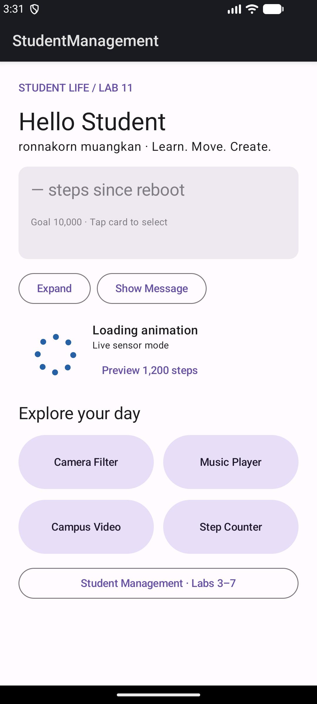
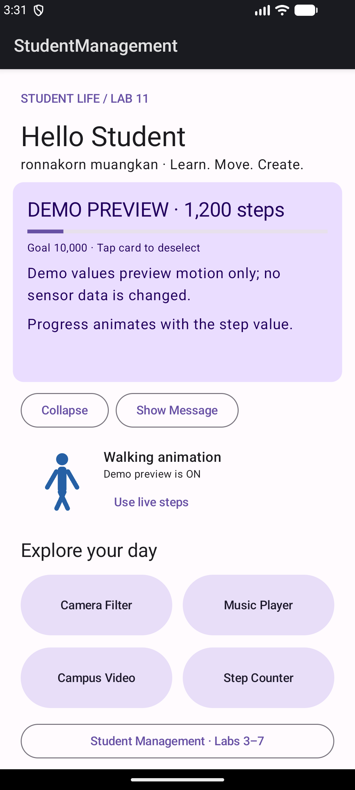
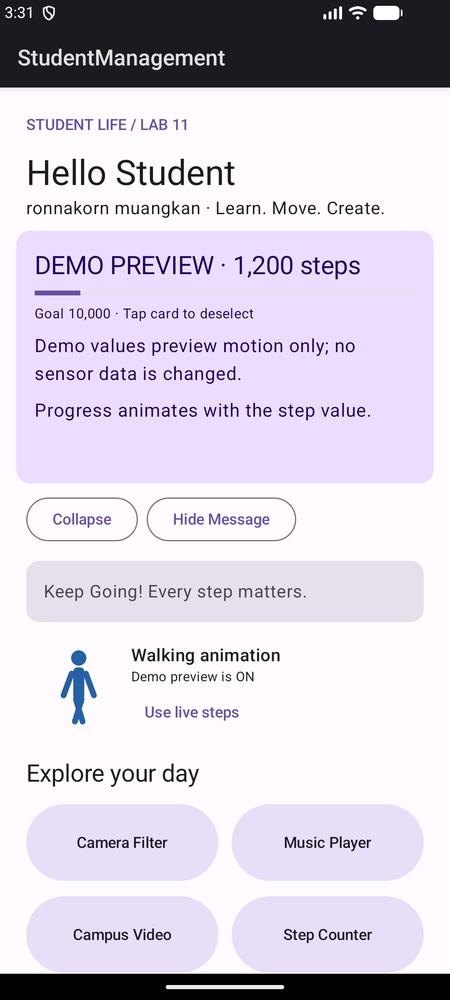

# Lab 11 — Animation and Motion

ผู้จัดทำ: **ronnakorn muangkan**  
โปรเจกต์: Animated Student Life Dashboard ต่อจาก Lab 10  
วันที่ตรวจและจัดชุดส่ง: **24 ตุลาคม 2026**

## 1. การพัฒนาต่อจาก Lab 10

ใช้ StudentManagement โปรเจกต์เดิม ไม่สร้างแอปใหม่ หน้า Home เชื่อม Camera, Music, Video และ Sensor เดิม รวมทั้งระบบ JWT, Room, Retrofit, Hilt และ WorkManager จาก Labs ก่อนหน้า

ตรวจข้อกำหนด Animation ที่มีจาก Lab 9 ให้ตรงกับใบงาน Lab 11 เปลี่ยนหัวข้อ Home เป็น LAB 11 และปรับ Step Card ให้เปลี่ยน Scale, Alpha และสีพร้อมกันด้วย Transition เดียว

## 2. สรุปตามขั้นในใบงาน

| ขั้น | สิ่งที่ทำ | จุดตรวจในโค้ด |
| --- | --- | --- |
| 1–3 Property Animation | expanded, Expand/Collapse, ความสูง 120 → 220 dp | HomeScreen.kt / animateDpAsState |
| 4–6 AnimatedVisibility | Show/Hide Message พร้อม Fade + Slide ทั้งเข้าและออก | HomeScreen.kt / AnimatedVisibility |
| 7–8 Transition | แตะ Step Card เปลี่ยน scale, alpha และสีพร้อมกัน | updateTransition + animateFloat + animateColor |
| 9–11 Lottie | dependency และ loading.json/walking.json, composable โหลดและเล่น | LoadingAnimation.kt และ res/raw |
| 12 สลับ Loading/Walking | ต่ำกว่า 1,000 แสดง loading; ตั้งแต่ 1,000 แสดง walking | StepProgress.walking และ HomeScreen |
| 13 Screen Transition | Camera/Sensor Slide, Music Fade, Video Scale + Fade | MainActivity.kt / Navigation Compose |

## 3. Header และ Feature Cards

Header “Hello Student” เข้าหน้าด้วย fadeIn + slideInVertically ระยะ 600 ms ส่วน Feature Cards ใช้ AnimatedVisibility และหน่วงแถวที่สอง 120 ms ทำให้รายการค่อย ๆ ปรากฏตามลำดับ ไม่สร้าง Animation ใหม่ทุกครั้งที่ UI recompose

## 4. Property Animation และ Progress

ปุ่ม Expand เปลี่ยน expanded = true จากนั้น animateDpAsState เปลี่ยนความสูงจาก 120.dp เป็น 220.dp ด้วย tween 500 ms และ Collapse ย้อนกลับ Compose คำนวณค่าระหว่างทาง จึงไม่ต้องเขียน loop เพิ่มขนาดเอง

Progress ใช้ animateFloatAsState ระยะ 800 ms กับเป้าหมาย steps / 10000f และจำกัดค่าในช่วง 0–1 เมื่อจำนวนก้าวเปลี่ยน แถบจะเคลื่อนไปยังค่าใหม่อย่างต่อเนื่อง

## 5. AnimatedVisibility

ปุ่ม Show Message และ Hide Message เปลี่ยน state เพื่อแสดงข้อความ “Keep Going! Every step matters.” โดยใช้ enter = fadeIn() + slideInVertically() และ exit = fadeOut() + slideOutVertically() การใช้ transition เข้า/ออกทำให้ผู้ใช้ตามการเปลี่ยน UI ได้ง่ายกว่าการปรากฏหรือหายทันที

## 6. updateTransition

Step Card ใช้ selected state ร่วมกันสาม property:

| Property | ไม่เลือก | เลือก |
| --- | --- | --- |
| Scale | 1.0 | 1.05 |
| Alpha | 0.7 | 1.0 |
| สี | surfaceVariant | primaryContainer |

scale และ alpha ส่งให้ graphicsLayer ส่วนสีส่งให้ CardDefaults.cardColors ทั้งสามมาจาก updateTransition เดียวกัน เมื่อแตะซ้ำจะเปลี่ยนกลับ เหมาะกับหลาย property ที่ต้องตอบสนองต่อสถานะเดียวกัน ส่วน animate*AsState ใช้กับค่าเป้าหมายเดี่ยวอย่างความสูงและ progress

## 7. Lottie และข้อมูลเซนเซอร์

LoadingAnimation.kt ใช้ rememberLottieComposition อ่าน R.raw.loading หรือ R.raw.walking และ animateLottieCompositionAsState วนด้วย LottieConstants.IterateForever ส่ง progress ให้ LottieAnimation ตัว animation หยุดเมื่อ lifecycle ของ Home ไม่อยู่ใน STARTED

เงื่อนไขจริงคือ steps < 1000 → loading และ steps >= 1000 → walking ไฟล์ JSON เป็น vector animation ที่สร้างสำหรับโปรเจกต์นี้และเล่นแบบออฟไลน์ ไม่ต้องดาวน์โหลดขณะใช้งาน ใช้ lottie-compose 6.4.1 ที่เข้ากับ toolchain เดิม ไม่ได้อ้างว่าเป็นรุ่นล่าสุด

Emulator ไม่มี Step Counter จึงแสดง — ในโหมด live มีปุ่ม Preview 1,200 steps สำหรับทดสอบ progress และการสลับ Lottie โดยมีป้าย **DEMO PREVIEW** และ **Demo preview is ON** ค่า Demo ไม่เขียนกลับ sensor หรือฐานข้อมูล กด Use live steps เพื่อกลับไปข้อมูลจริง การเดินเพิ่มก้าวจริงยังต้องทดสอบบนโทรศัพท์ที่มี Step Counter

## 8. Navigation Animation

Navigation Compose 2.7.7 ของโปรเจกต์กำหนด enterTransition และ exitTransition ต่อ destination:

- Camera: Slide แนวนอน 450 ms
- Music: Fade 450 ms
- Video: Scale จาก 0.85 เป็น 1.0 พร้อม Fade
- Sensor: Slide แนวนอน 450 ms

แต่ละหน้ามีปุ่มกลับ Home และรองรับปุ่ม Back ของ Android โดยยังใช้ NavHost เดิม ไม่สร้าง Activity ใหม่เพื่อทำ Animation

## 9. คลิปและผลตรวจ

[คลิป Dashboard จริงจาก Emulator](evidence/lab11/dashboard-motion.mp4) แสดง state ของ Lab 11 รวม Lottie, Expand/Collapse, เลือก card และ Show/Hide Message มี [คลิปสลับ Loading/Walking และ Progress เพิ่มเติม](evidence/lab11/progress-lottie.mp4)

ภาพในรายงานและคลิปเป็นผลจากแอปจริง ไม่ใช่ mockup ภาพนิ่งใช้ตรวจ layout ส่วนคลิปใช้ดู motion

ผลรอบใหม่: **Build สำเร็จ และ Unit Test 15/15 ผ่าน (0 failures, 0 errors)** ติดตั้ง APK และเปิดหน้า Home LAB 11 ได้

ผล Build และ Unit Test รอบใหม่อยู่ใน [Gradle log](evidence/lab11/gradle-build.log) และ [สรุปผลทดสอบ](evidence/lab11/test-summary.txt) พร้อม JUnit XML ดั้งเดิม Tests ตรวจ business behavior ของ Repository/Use Case/ViewModel และการจำกัด progress กับ threshold 999/1000 ของ StepProgress ส่วนความลื่นไหลและ layout ตรวจบน Emulator ไม่อ้างว่า JVM tests พิสูจน์ Animation ทุกเฟรม

## 10. วิธีเปิดและส่งงาน

แตก ZIP รายงานก่อนเปิด LAB11_Report.md โดยให้ evidence อยู่คู่กัน เพื่อแสดงภาพและเปิดคลิปได้ ชุด source ใช้ Android Studio, JDK 17, SDK 34 หรือใช้ APK debug ที่แนบสำหรับทดสอบ

Backend ใช้ชุดเดิมตาม student-api/README.md โดยสร้าง .env และ JWT_SECRET ของเครื่องผู้ตรวจ Login สาธิต ronnakorn / Lab3pass123! แล้วเข้าสู่ Student Life แอปใช้ http://10.0.2.2:8000/ บน Emulator

การส่งงานไม่ต้องติดตั้ง APK ส่ง ZIP รายงานพร้อม ZIP โค้ดตามที่ผู้สอนกำหนด APK ใช้เมื่อต้องการรันตรวจบน Android เท่านั้น
