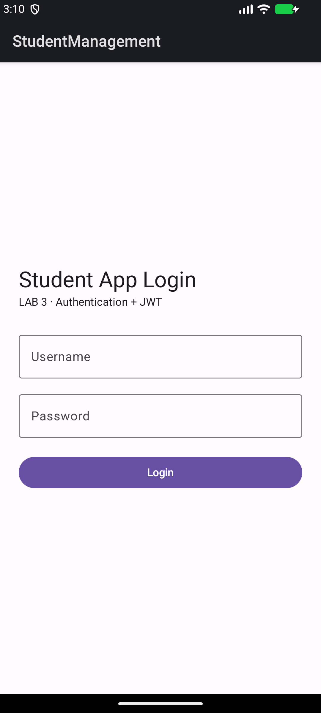
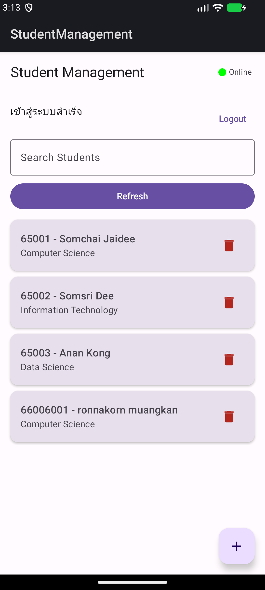
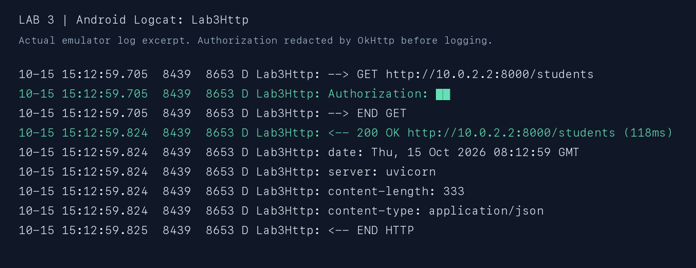
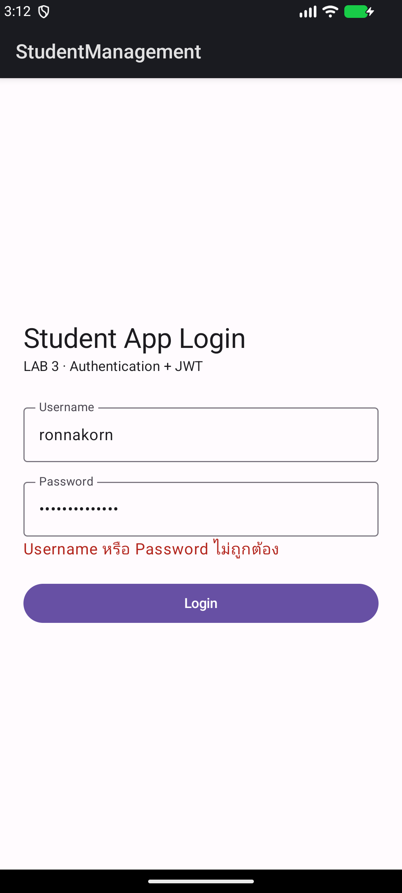

# LAB 3: Authentication + JWT

ผู้จัดทำ: **ronnakorn muangkan**  
โครงการ: Student Management ต่อยอดจาก Lab 2  
วันที่ทดสอบ: 15 ตุลาคม 2026

## 1. ภาพหน้าจอ Login



หน้า Login สร้างด้วย Jetpack Compose มีช่อง Username และ Password โดยซ่อนตัวอักษรรหัสผ่าน เมื่อกด Login จะเรียก `LoginViewModel` ส่งข้อมูลแบบ form ผ่าน Retrofit ไปที่ `POST /token` บน FastAPI ระหว่างส่งคำขอจะปิดปุ่มเพื่อป้องกันการกดซ้ำ และแสดงข้อความเมื่อเข้าสู่ระบบไม่สำเร็จ

บัญชีที่ใช้ทดสอบใน Lab คือ Username `ronnakorn` และ Password `Lab3pass123!` เป็นบัญชีสาธิตของงานนี้ ไม่ใช่รหัสผ่านบัญชีส่วนตัว

## 2. ภาพผล Login สำเร็จ



เมื่อกรอกข้อมูลถูกต้อง Backend ตอบกลับ HTTP 200 พร้อม Access Token ชนิด Bearer แอปบันทึก Token ผ่าน `TokenStorage` และแสดงหน้ารายการนักศึกษา พร้อมข้อความ “เข้าสู่ระบบสำเร็จ” และสถานะ Online

ภาพแสดงข้อมูลจาก PostgreSQL รวมถึง `66006001 — ronnakorn muangkan — Computer Science` ที่เพิ่มใน Lab 2 การโหลดรายชื่อต้องผ่านการตรวจ Token ที่ Backend ก่อน จึงยืนยันได้ทั้งการ Login และการเรียก Protected API

ทดสอบปิดแล้วเปิดแอปใหม่ พบว่าแอปใช้ Token ที่เก็บไว้โหลดรายการได้ โดยไม่ต้องกรอกรหัสผ่านซ้ำ

## 3. ภาพ Request Header โดยไม่เปิดเผย Token จริง



ภาพนี้นำข้อความจาก Android Logcat จริง (tag `Lab3Http`) มาแสดงเป็นภาพเพื่อให้อ่านได้ชัดเจน ไม่ใช่ภาพจำลองผล API และสามารถตรวจข้อความต้นฉบับได้ใน [request-headers.log](evidence/lab3/request-headers.log)

ในภาพมีคำขอ `GET http://10.0.2.2:8000/students`, Header `Authorization: ██` และผลตอบกลับ `200 OK` การปิดบังทำด้วย `redactHeader("Authorization")` ก่อนเขียน Log จึงไม่มี Token จริงอยู่ในไฟล์หลักฐาน และไม่บันทึก request/response body ที่อาจมีรหัสผ่านหรือ Token

รูปแบบ Header ที่แอปส่งจริงคือ:

```http
Authorization: Bearer <access_token>
```

`<access_token>` ในตัวอย่างเป็นตัวแทนเท่านั้น ไม่ใช่ Token ที่ใช้งานได้ `AuthInterceptor` อ่าน Token จาก `TokenStorage` แล้วแนบ Header ให้คำขอที่ต้องยืนยันตัวตน ส่วนคำขอ Login ไม่แนบ Token

## 4. JWT มีหน้าที่อะไร และทำไม Backend ต้องตรวจสอบ Token

### JWT มีหน้าที่อะไร

JWT (JSON Web Token) เป็นรูปแบบ Token ที่บรรจุข้อมูลอ้างสิทธิ์หรือ claims หลังจาก Backend ตรวจ Username และ Password ถูกต้อง จะออก JWT ที่มีลายเซ็นให้แอปนำไปใช้ยืนยันตัวตนในการเรียก API ครั้งถัดไป โดยไม่ต้องส่งรหัสผ่านซ้ำทุกคำขอ

ในงานนี้ JWT มีข้อมูลสำคัญดังนี้:

| Claim | หน้าที่ |
| --- | --- |
| `sub` | ระบุผู้ใช้เจ้าของ Token เช่น `ronnakorn` |
| `iat` | เวลาที่ออก Token |
| `exp` | เวลาหมดอายุ ในงานนี้กำหนดอายุ 30 นาที |

JWT แบบลงลายเซ็นที่ใช้ในงานนี้ประกอบด้วย Header, Payload และ Signature คั่นด้วยจุด ส่วน Header ระบุอัลกอริทึม HS256 และ Signature ใช้ตรวจว่าข้อมูลถูกแก้ไขหรือไม่ ด้วย Secret ที่เก็บเฉพาะฝั่ง Backend

**JWT ที่ลงลายเซ็นไม่ได้หมายความว่าเนื้อหาถูกเข้ารหัสลับ** ผู้ที่ได้ Token สามารถอ่าน Payload ได้ จึงไม่ควรใส่รหัสผ่านหรือข้อมูลลับลงใน Payload ผู้ที่ครอบครอง Bearer Token อาจใช้เรียก API แทนเจ้าของได้ ต้องป้องกัน Token และใช้ HTTPS ในระบบจริง

### ทำไม Backend ต้องตรวจสอบ Token

การซ่อนหน้ารายการไว้หลังหน้า Login ป้องกันได้เพียงการใช้งานผ่านหน้าจอปกติ ผู้ใช้ยังสามารถส่ง HTTP request ตรงไปยัง API ด้วยเครื่องมือทดสอบหรือโปรแกรมอื่นได้ ดังนั้น Backend ต้องตรวจ Token **ทุกคำขอที่เข้า Protected API** ก่อนอ่านหรือแก้ไขฐานข้อมูล

ในงานนี้ Backend ตรวจว่า:

1. มี Bearer Token ใน Authorization Header
2. ลายเซ็นถูกต้อง โดยยอมรับเฉพาะ HS256 ที่กำหนดไว้ ไม่เลือกอัลกอริทึมตาม Token อย่างอิสระ
3. มี claims ที่จำเป็น ได้แก่ `sub`, `iat` และ `exp` และ Token ยังไม่หมดอายุ
4. `sub` เป็นผู้ใช้ที่ระบบยอมรับ

หากไม่ผ่านจะตอบ HTTP 401 พร้อม `WWW-Authenticate: Bearer` และไม่ดำเนินการ CRUD แอปจะลบ Token เมื่อได้รับ 401 และกลับหน้า Login ส่วน 401/403 จะไม่ถูกนำไปใช้เป็นเหตุให้แสดงข้อมูล cache แบบ Offline แทนการยืนยันตัวตน

การยืนยันตัวตนกับการตรวจสิทธิ์เป็นคนละเรื่อง: Token ช่วยบอกว่าเป็นใคร แต่ระบบหลายบทบาทยังต้องตรวจว่าผู้ใช้นั้นมีสิทธิ์อ่าน แก้ไข หรือลบทรัพยากรที่ร้องขอหรือไม่ งานนี้ใช้บัญชีสาธิตหนึ่งบัญชีที่เข้าถึง Student API ได้ทั้งหมด ยังไม่ได้ทำ role-based authorization

### การเก็บ Token และ Logout

งานนี้ใช้ SharedPreferences แบบ `MODE_PRIVATE` ตามแนวทางในใบงาน และปิด Android backup แต่ไม่ได้ถือว่า SharedPreferences เป็นการเข้ารหัส Token ในระบบจริงควรใช้การป้องกันที่เหมาะสม เช่น Android Keystore

Logout จะลบ Token ในเครื่องและกลับหน้า Login โดยไม่เก็บรหัสผ่านไว้หลัง Login สำเร็จ อย่างไรก็ตาม Logout แบบนี้ไม่ได้เพิกถอนสำเนา Token ที่ถูกคัดลอกไปก่อนหน้า สำเนาดังกล่าวยังใช้ได้จนหมดอายุ หากต้องการเพิกถอนทันทีต้องเพิ่มกลไก revocation ฝั่ง Backend

## ผลทดสอบ

| กรณี | ผลที่ตรวจได้ |
| --- | --- |
| Login ด้วยข้อมูลถูกต้อง | HTTP 200, เก็บ Token และโหลดรายชื่อได้ |
| Password ผิด | HTTP 401 และแอปแสดงข้อความแจ้งข้อผิดพลาด |
| ปิดและเปิดแอปใหม่หลัง Login | ใช้ Token เดิมและโหลดรายชื่อได้ |
| เรียก Student API พร้อม Token ถูกต้อง | HTTP 200; Log มี Authorization ที่ปิดบังค่าแล้ว |
| ไม่ส่ง Token | Student endpoints ทั้ง GET list, GET detail, POST, PUT และ DELETE คืน 401 |
| แก้ไขลายเซ็น Token | HTTP 401 |
| Token หมดอายุ | HTTP 401 |
| เอา Token ออกจากคำขอถัดไป | HTTP 401 |
| Logout บน Android | กลับหน้า Login และตรวจพบว่าไม่มี access_token ใน preferences |
| CRUD หลังยืนยันตัวตน | ผ่าน และลบรายการทดสอบชั่วคราวแล้ว |
| Android unit tests | ผ่าน 4 tests ไม่มี failure รวมการไม่ fallback เป็น cache เมื่อได้ 401 |

ภาพเพิ่มเติมเมื่อรหัสผ่านผิด:



## วิธีรันและตรวจงาน

1. เปิด Docker Desktop แล้วเข้า `student-api`
2. สร้าง `.env` สำหรับ JWT Secret ครั้งแรกตาม `student-api/README.md` แล้วรัน `docker compose up -d --build`
3. เปิด Android ใน Android Studio โดยใช้ JDK 17 และ SDK 34 แล้ว Run แบบ debug บน Emulator หรือใช้ APK ที่แนบ
4. Login ด้วยบัญชีสาธิตด้านบน ค่า API สำหรับ Emulator คือ `http://10.0.2.2:8000/`
5. เปิด `http://localhost:8000/docs` แล้วใช้ Authorize ก่อนเรียก Student API
6. ทดสอบ backend ด้วย `docker compose exec -T api python auth_smoke_test.py`
7. ทดสอบ Android ด้วย `./gradlew testDebugUnitTest`

HTTP ใช้เฉพาะการทดลองในเครื่องนี้ ส่วนการใช้งานจริงควรเปลี่ยนเป็น HTTPS ไฟล์ `.env` ที่มี JWT Secret และ Token จริงไม่รวมในชุดส่งงาน

## เอกสารอ้างอิง

- ใบงาน LAB 3 Authentication + JWT ที่ผู้สอนให้มา
- [FastAPI: OAuth2 with Password and Bearer with JWT tokens](https://fastapi.tiangolo.com/tutorial/security/oauth2-jwt/)

ภาพในรายงานใช้พาธสัมพัทธ์ เพื่อให้เปิดบนเครื่องผู้ตรวจได้ กรุณาส่งไฟล์ Markdown พร้อมโฟลเดอร์ `evidence/lab3` หรือส่ง ZIP ที่รวมทั้งสองส่วนไว้แล้ว
