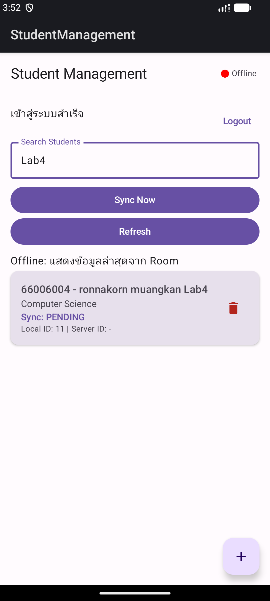
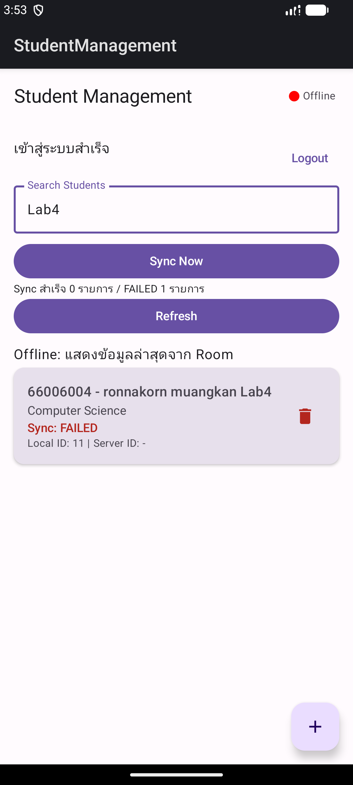
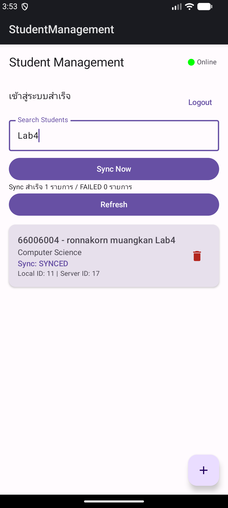
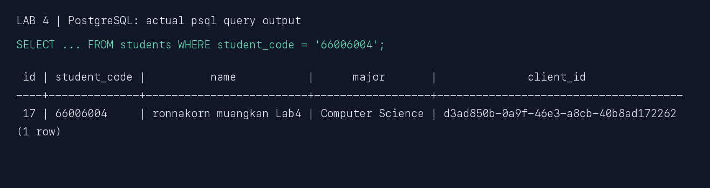

# LAB 4: Offline-First + Synchronization

ผู้จัดทำ: **ronnakorn muangkan**  
วันที่ทดสอบ: 15 ตุลาคม 2026  
ต่อยอดจาก Student Management Lab 2 และ Authentication + JWT Lab 3

## 1. แนวคิดและสิ่งที่พัฒนา

Offline-First คือให้แอปอ่านและบันทึกข้อมูลในฐานข้อมูลของเครื่องได้ก่อน แม้เครือข่ายไม่พร้อม แล้วจึงส่งข้อมูลไป Server ภายหลัง ในงานนี้ UI อ่านรายการจาก Room ผ่าน `Flow` และ `StateFlow` จึงไม่ต้องรอการเรียก API ทุกครั้งเพื่อแสดงรายการ การ Refresh จะรวมข้อมูล Server ลง Room และไม่ลบข้อมูล PENDING/FAILED ที่ยังส่งไม่สำเร็จ

```text
Compose ← StateFlow ← Repository ← Room (แหล่งข้อมูลหลักของหน้าจอ)
                           │
                     Sync Now + JWT
                           ↓
                        Retrofit
                           ↓
                        FastAPI
                           ↓
                       PostgreSQL
```

ใช้ Entity `Student` เดิม ไม่สร้าง Entity ซ้ำ และคง `id` เป็น Primary Key ของ Room เพียงตัวเดียว โดยในหน้าจอเรียกว่า Local ID

| Field | หน้าที่ |
| --- | --- |
| `id` | Local ID ที่ Room สร้างและไม่เปลี่ยนหลัง Sync |
| `serverId` | ID ที่ Server ส่งกลับมา ยังเป็น null ก่อน Sync |
| `syncStatus` | PENDING, FAILED หรือ SYNCED |
| `updatedAt` | เวลาที่บันทึกหรือแก้ไขในเครื่อง ยังไม่ใช้ตัดสิน conflict หลายอุปกรณ์ |
| `clientId` | UUID ประจำรายการ ใช้ค่าเดิมเมื่อลองส่งซ้ำ |

Room ใช้ migration จาก version 1 เป็น 2 โดยเพิ่มคอลัมน์และคัดลอก id เดิมไป serverId ทดสอบอัปเดตทับแอป Lab 3 โดยไม่ล้างข้อมูล พบข้อมูลเดิม 4 คนยังอยู่และเป็น SYNCED

## 2. เพิ่มข้อมูลขณะ Offline: PENDING



ขั้นตอนทดสอบจริง:

1. Login ขณะออนไลน์ด้วยบัญชี Lab 3
2. ปิดทั้ง Wi-Fi และ mobile data ของ Android Emulator
3. เพิ่มรายการทดสอบ `66006004 / ronnakorn muangkan Lab4 / Computer Science`
4. บันทึกลง Room โดยไม่เรียก POST แล้วเปิดแอปใหม่ขณะยัง Offline
5. ค้นคำว่า `Lab4` พบข้อมูลยังอยู่ มี Local ID 11, Server ID ยังไม่มี และสถานะ PENDING

ก่อน Sync ตรวจ PostgreSQL ด้วยรหัส `66006004` ไม่พบข้อมูล (0 rows) หลักฐานข้อความอยู่ใน [postgres-before-sync.txt](evidence/lab4/postgres-before-sync.txt)

## 3. ส่งไม่สำเร็จ: FAILED และลองใหม่ได้



กด Sync Now ขณะยังปิดเครือข่าย พบ “Sync สำเร็จ 0 รายการ / FAILED 1 รายการ” ข้อมูลยังอยู่ใน Room ไม่หายจากรายการ การ Sync ครั้งถัดไปจะเลือกทั้ง PENDING และ FAILED มาลองใหม่

โค้ดทำเครื่องหมาย FAILED ก่อนส่งคำขอ เพื่อให้หากแอปหยุดหรือผลตอบกลับสูญหาย รายการยังอยู่ในคิวที่ลองส่งใหม่ได้ เมื่อสำเร็จจึงเปลี่ยนเป็น SYNCED ไม่ใช้ FAILED เป็นเหตุลบข้อมูล

## 4. เปิดเครือข่ายและ Sync สำเร็จ



เปิด Wi-Fi และ mobile data กลับ แล้วกด Sync Now ผลคือ Sync สำเร็จ 1 รายการ ไม่มี FAILED, Local ID ยังคงเป็น **11**, ได้ Server ID **17** และสถานะเปลี่ยนเป็น **SYNCED**

ลำดับการทำงาน:

1. Repository อ่านข้อมูล PENDING/FAILED จาก DAO
2. ส่ง POST /students พร้อมข้อมูลนักศึกษาและ client_id โดย AuthInterceptor แนบ Bearer JWT
3. Backend ตรวจ Token แล้วบันทึก PostgreSQL
4. Server ส่ง ID กลับมา
5. Repository อัปเดตแถวเดิมใน Room ด้วย serverId และ SYNCED
6. Flow จาก Room ส่งรายการใหม่ให้หน้าจอโดยอัตโนมัติ

## 5. ตรวจข้อมูลใน PostgreSQL



ภาพนี้แสดงข้อความผลลัพธ์จริงจาก `psql` ที่จัดเป็นภาพให้อ่านง่าย ไม่ใช่ผลลัพธ์จำลอง ต้นฉบับอยู่ใน [postgres-after-sync.txt](evidence/lab4/postgres-after-sync.txt)

พบข้อมูลรหัส 66006004 จำนวน 1 แถว เป็น ID 17 ตรงกับ Server ID ใน Android พร้อม client_id เดียวกับรายการที่ส่งจากมือถือ

## 6. คำอธิบายและคำตอบประกอบ Lab

### ทำไมต้องเก็บใน Room ก่อน

เพื่อให้ผู้ใช้เพิ่มข้อมูลได้ทันทีโดยไม่ต้องรอเครือข่าย ข้อมูลคงอยู่หลังปิดแล้วเปิดแอปใหม่ และสามารถส่งไป Server เมื่อพร้อมได้ Room เป็นแหล่งข้อมูลหลักของ UI ส่วน PostgreSQL เป็นฐานข้อมูลส่วนกลาง

### ความหมายของสถานะ Sync

- **PENDING:** บันทึกในเครื่องแล้ว ยังไม่ส่งสำเร็จและรอผู้ใช้กด Sync
- **FAILED:** เคยพยายามส่งแต่ยังยืนยันความสำเร็จไม่ได้ เก็บไว้ให้ตรวจสอบหรือลองใหม่
- **SYNCED:** Server ตอบกลับสำเร็จและ Room บันทึก serverId แล้ว

### ทำไมต้องแยก Local ID กับ Server ID

มือถือสร้างข้อมูลได้แม้ยังไม่ติดต่อ Server จึงต้องมี ID ของตัวเอง PostgreSQL อาจสร้างเลข ID ที่ต่างออกไป การเก็บ serverId แยกทำให้ทราบว่าจะอ้างถึงแถวใดบน Server โดยไม่ต้องเปลี่ยน Primary Key ของ Room หรือทำให้รายการใน UI เปลี่ยนตัวตน

### ป้องกันข้อมูลซ้ำเมื่อ Sync ใหม่อย่างไร

ทุกแถวใหม่มี UUID `clientId` ที่สร้างในมือถือและส่งเป็น JSON `client_id` Backend ใช้ unique index และ `INSERT ... ON CONFLICT DO NOTHING` เพื่อให้คำขอซ้ำคืน Server ID เดิม หากใช้ client_id เดิมแต่เปลี่ยน payload จะคืน HTTP 409 แทนการเขียนทับเงียบ ๆ

จึงรองรับกรณี Server บันทึกสำเร็จแต่คำตอบไม่ถึงมือถือ: แอปยังเป็น FAILED และส่งซ้ำด้วย UUID เดิมได้โดยไม่เพิ่มแถวซ้ำ ทดสอบจริงด้วยคำขอพร้อมกัน 4 ครั้งแล้วได้ Server ID เดียวและข้อมูลเพียง 1 แถว ส่วนฝั่งแอปใช้ Mutex ป้องกัน Sync ซ้อนกัน

### Refresh กับ Sync Now ต่างกันอย่างไร

Refresh ดึงข้อมูลจาก Server แล้วรวมลง Room โดยรักษาข้อมูลที่ยังไม่ Sync ส่วน Sync Now ส่ง PENDING/FAILED จาก Room ไป Server แล้ว Refresh ผลล่าสุด การแสดงผลทั้งสองกรณีอ่านจาก Room ผ่าน Flow เหมือนกัน

### JWT จาก Lab 3 ยังทำงานหรือไม่

ยังตรวจ JWT ทุก Student endpoint เมื่อไม่มี Token, Token ปลอม หรือหมดอายุ Backend ตอบ 401 แอปจะลบ Token และกลับ Login ข้อมูลในคิวไม่ถูกลบทิ้ง หลัง Login ใหม่สามารถ Sync ต่อได้ การโหลด Offline เป็นการอ่านข้อมูลในเครื่องของ session ที่มี Token อยู่ ไม่ใช่การให้ Backend ยอมรับ Token โดยไม่ตรวจสอบ

## 7. ผลทดสอบและขอบเขต

| รายการ | ผล |
| --- | --- |
| Android assembleDebug | ผ่าน |
| Unit tests Repository | 6 tests ผ่าน ไม่มี failure |
| Migration จากแอปเดิม | ข้อมูลเดิม 4 คนยังอยู่ |
| เพิ่มข้อมูลขณะปิดเครือข่าย | บันทึกใน Room และเป็น PENDING |
| เปิดแอปใหม่ขณะ Offline | ข้อมูลที่บันทึกยังอยู่ |
| Sync ขณะ Offline | FAILED และรายการไม่หาย |
| เปิดเครือข่ายแล้วลองใหม่ | SYNCED, Local ID 11 / Server ID 17 |
| ตรวจ PostgreSQL | พบรายการที่เพิ่มจาก Android |
| Backend concurrent retries | ส่งซ้ำ 4 คำขอ ได้แถวเดียว |
| client_id เดิม แต่ payload ต่าง | คืน 409 โดยไม่เขียนทับ |
| JWT และ authenticated CRUD | ผ่าน regression tests |

Unit tests ครอบคลุมการเพิ่มโดยไม่เรียกเครือข่าย, Flow, Local ID คงเดิม, ลองใหม่เมื่อคำตอบสูญหาย, Refresh ไม่ลบคิว, cancellation/401 และ Sync พร้อมกัน

งานนี้ทำคิวเฉพาะ **การเพิ่มข้อมูล** ตามใบงาน ไม่ได้เพิ่ม background sync หรือ offline update/delete สำหรับข้อมูลบน Server แล้ว รายการ PENDING ที่ยังไม่เคยส่งแก้ไขและลบในเครื่องได้ ส่วน FAILED ต้อง Sync ให้ทราบผลก่อนแก้ไข/ลบ ข้อมูลที่ SYNCED แล้วใช้ PUT/DELETE แบบออนไลน์เช่นเดิม ระบบยังเป็นบัญชีสาธิตหนึ่งบัญชี ไม่มีการแบ่งคิวหลายผู้ใช้หรือระบบแก้ conflict หลายอุปกรณ์

## 8. วิธีรันและส่งงาน

- อ่าน `student-api/README.md` เพื่อสร้าง `.env` ที่มี JWT_SECRET แล้วรัน `docker compose up -d --build`
- เปิด StudentManagement ใน Android Studio ใช้ JDK 17 / SDK 34 หรือใช้ APK ที่แนบ
- Login ด้วย `ronnakorn / Lab3pass123!` (บัญชีสาธิต)
- เพิ่มข้อมูลโดยปิดเครือข่าย แล้วเปิดเครือข่ายและกด Sync Now
- Android Emulator ใช้ API `http://10.0.2.2:8000/`
- ตรวจชุดทดสอบด้วย `./gradlew testDebugUnitTest` และ `docker compose exec -T api python sync_smoke_test.py`
- ภาพใน Markdown เป็นพาธสัมพัทธ์ ต้องส่งพร้อมโฟลเดอร์ evidence/lab4 หรือใช้ ZIP รายงาน

แนบ SQL backup ฉบับ Lab 4 ให้ในชุดโค้ด หากต้องการข้อมูลตรงกับภาพให้สร้างฐานข้อมูลว่างใหม่แล้วนำเข้า ไม่ควรนำเข้าทับฐานข้อมูลที่มีตาราง students อยู่แล้ว

## เอกสารอ้างอิง

- ใบงาน LAB 4 Offline-First + Synchronization
- [Android Developers: Room database migrations](https://developer.android.com/training/data-storage/room/migrating-db-versions)
- [PostgreSQL 16: INSERT และ ON CONFLICT](https://www.postgresql.org/docs/16/sql-insert.html)
