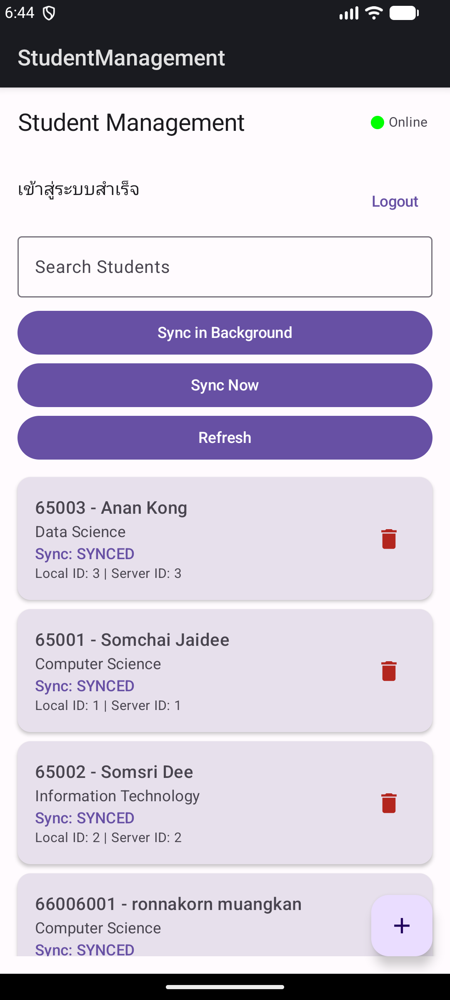
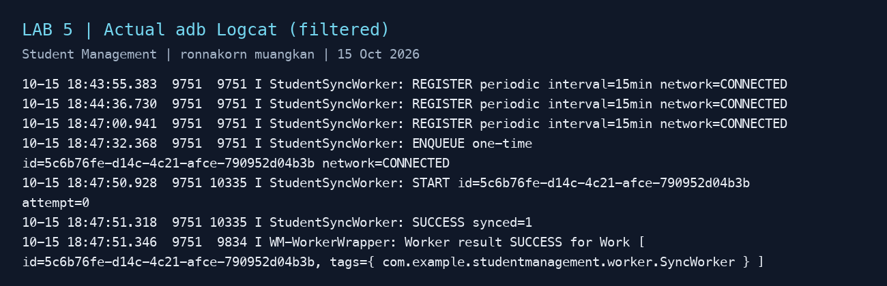
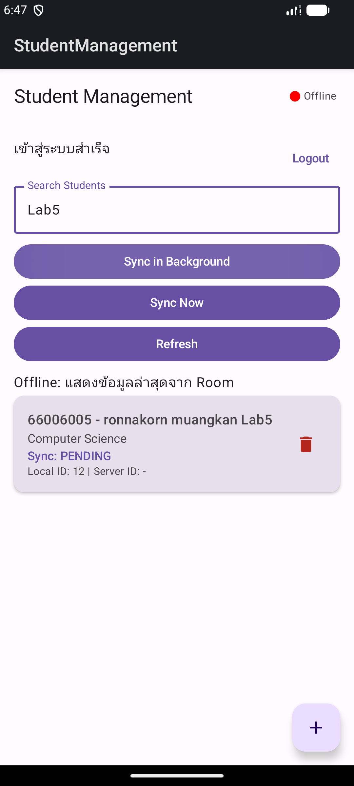
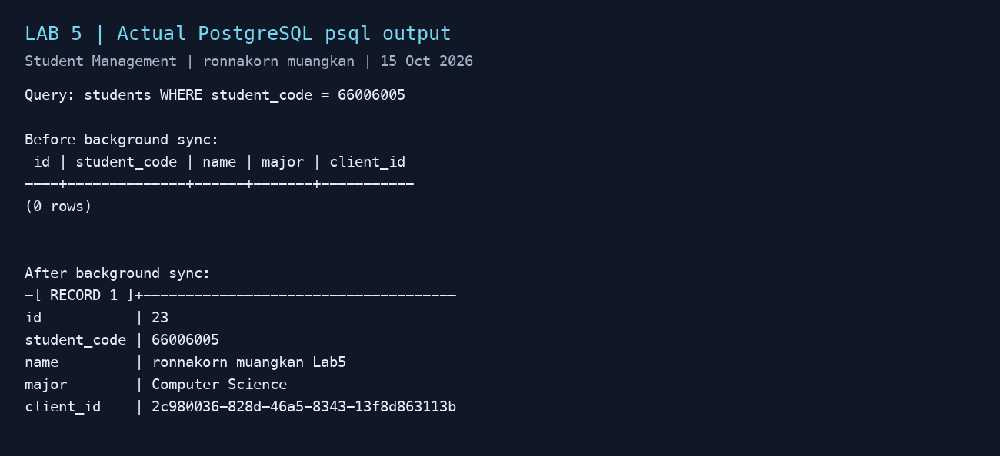
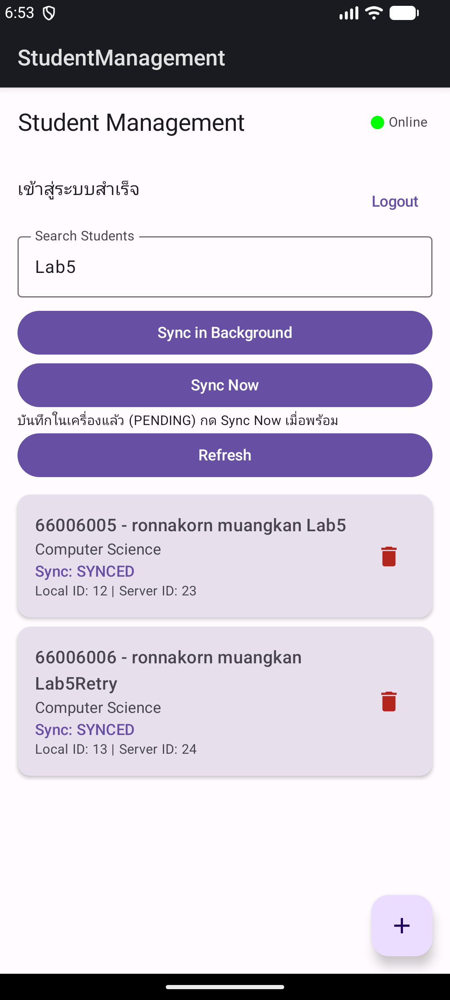

# LAB 5 — WorkManager + Background Synchronization

ผู้จัดทำ: **ronnakorn muangkan**  
วันที่ทดสอบ: 15 ตุลาคม 2026

งานนี้เป็นโค้ดรวม Lab 3–7: ใช้ JWT จาก Lab 3, คิว Room จาก Lab 4, WorkManager จาก Lab 5, Hilt จาก Lab 6 และ Use Case จาก Lab 7 ดังนั้น Worker รุ่นส่งงานรับ dependency ผ่าน Hilt และเรียก SyncStudentsUseCase แทน AppContainer แบบ Manual ในตัวอย่างเริ่มต้นของ Lab 5

## 1. ภาพปุ่ม Sync in Background

เมื่อกดปุ่ม แอปเรียก SyncScheduler เพื่อสร้าง OneTimeWorkRequest โดยกำหนด NetworkType.CONNECTED และใช้ unique work ชื่อ student-sync-once นโยบาย KEEP ป้องกันการกดซ้ำแล้วเกิดงานซ้อน งานถูกจัดคิวให้ WorkManager ทำต่อได้โดยไม่ผูกกับอายุของหน้าจอ

## 2. ภาพ Logcat ที่แสดง Worker ทำงาน

ภาพนี้นำข้อความจริงจาก adb Logcat มาจัดเป็นภาพให้อ่านง่าย ไม่ใช่ภาพหน้าต่าง Android Studio ต้นฉบับอยู่ใน [worker-logcat.txt](evidence/lab5/worker-logcat.txt) กรองเฉพาะ Worker ของแอป ไม่มี Token จริงใน Log

ลำดับทดสอบจริง:

1. Login แล้วปิด Wi-Fi และ mobile data ของ Emulator
2. เพิ่ม 66006005 / ronnakorn muangkan Lab5 / Computer Science ลง Room เป็น PENDING
3. กด Sync in Background ขณะ Offline: Log มี ENQUEUE แต่ยังไม่มี START ของงานนั้น และ PostgreSQL ยังไม่มีแถวนี้
4. เปิดเครือข่าย: WorkManager เริ่มงานเดิมเองโดยไม่ต้องกด Sync ซ้ำ
5. Log แสดง START attempt=0 และ SUCCESS synced=1 ข้อมูลใน Room เปลี่ยนเป็น SYNCED ได้ Server ID 23 โดย Local ID ยังคงเป็น 12

สถานะ Online/Offline ในแถบบนเป็นผลการ Refresh API ครั้งล่าสุด ไม่ใช่ตัวตรวจเครือข่ายแบบ realtime; การเปลี่ยนสถานะรายการมาจาก Room Flow หลัง Worker บันทึกผล

## 3. ภาพ PostgreSQL หลัง Sync

ผลจาก psql แสดงรหัส 66006005 เป็น ID 23 และชื่อถูกต้อง พร้อม client_id ซึ่งใช้ป้องกันข้อมูลซ้ำเมื่อส่งใหม่ ภาพนี้จัดรูปแบบจากผล query จริง ดูต้นฉบับ [ก่อน Sync](evidence/lab5/postgres-before.txt) และ [หลัง Sync](evidence/lab5/postgres-after.txt)

## 4. OneTimeWorkRequest ต่างจาก PeriodicWorkRequest อย่างไร

| ประเด็น | OneTimeWorkRequest | PeriodicWorkRequest |
| --- | --- | --- |
| วัตถุประสงค์ | งานหนึ่งครั้ง เช่น ผู้ใช้กด Sync | งานเกิดซ้ำ เช่น ตรวจคิว Sync เป็นระยะ |
| การทำงาน | รอเงื่อนไขแล้วทำจนสำเร็จ/ล้มเหลว/ยกเลิก และอาจมีหลาย attempt เมื่อ Retry | ระบบจัดรอบถัดไปเรื่อย ๆ จนยกเลิก |
| เวลา | ทำเมื่อระบบอนุญาตและ constraints ผ่าน ไม่รับประกันทันที | repeat interval ขั้นต่ำ 15 นาที เวลาอาจเลื่อนตามเงื่อนไขและระบบประหยัดแบตเตอรี่ |
| ในแอปนี้ | ปุ่ม Sync in Background, unique work KEEP, exponential backoff เริ่ม 30 วินาที | ลงทะเบียนหลังมี Token ด้วย interval และ initial delay 15 นาที, unique periodic KEEP |
| เงื่อนไข | ต้องมีเครือข่าย | ต้องมีเครือข่ายเช่นกัน |

การมีเครือข่ายไม่ได้รับประกันว่า API พร้อมใช้งาน เมื่อเจอ IOException, HTTP 429 หรือ 5xx Repository คืนจำนวน retryable ให้ Worker เลือก Result.retry(); error ถาวรใช้ Result.failure() และเมื่อทุกแถวสำเร็จใช้ Result.success() ส่วน cancellation ส่งต่อให้ WorkManager จัดการ งานทั้งสองชนิดถูกยกเลิกเมื่อ Logout

ช่วงขั้นต่ำและข้อจำกัดเวลาอ้างอิง [Android Developers: Define work requests](https://developer.android.com/develop/background-work/background-tasks/persistent/getting-started/define-work)

## 5. ทดสอบ Backend ไม่พร้อมและ Retry

เพิ่มรายการ 66006006 / ronnakorn muangkan Lab5Retry แล้วหยุด API ชั่วคราว โดยยังมีเครือข่าย กด Background Sync พบ START attempt=0 และ RETRY synced=0 failed=1 จากนั้นเปิด API กลับเพื่อให้ WorkManager ลองใหม่ด้วยงานเดิม หลักฐานผลการลองใหม่อยู่ใน [retry-logcat.txt](evidence/lab5/retry-logcat.txt)

ผลจริง: งาน UUID เดิมเริ่ม attempt=0 และ attempt=1 แล้ว Retry ก่อนสำเร็จที่ attempt=2 ได้ Server ID 24 โดย Local ID ยังคงเป็น 13

Periodic Work ลงทะเบียนไว้และมี Log REGISTER interval=15min; การทดสอบหลักนี้ยืนยัน OneTimeWorkRequest และ Retry ไม่อ้างว่าทดสอบรอบ Periodic ครบ 15 นาที

ไฟล์สำคัญในชุดโค้ด: worker/SyncScheduler.kt, worker/SyncWorker.kt, domain/usecase/SyncStudentsUseCase.kt และ data/repository/StudentRepositoryImpl.kt
