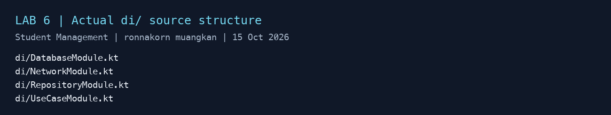
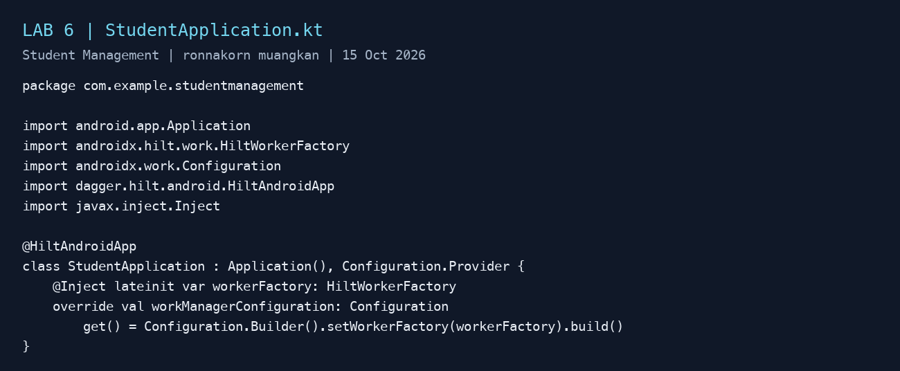
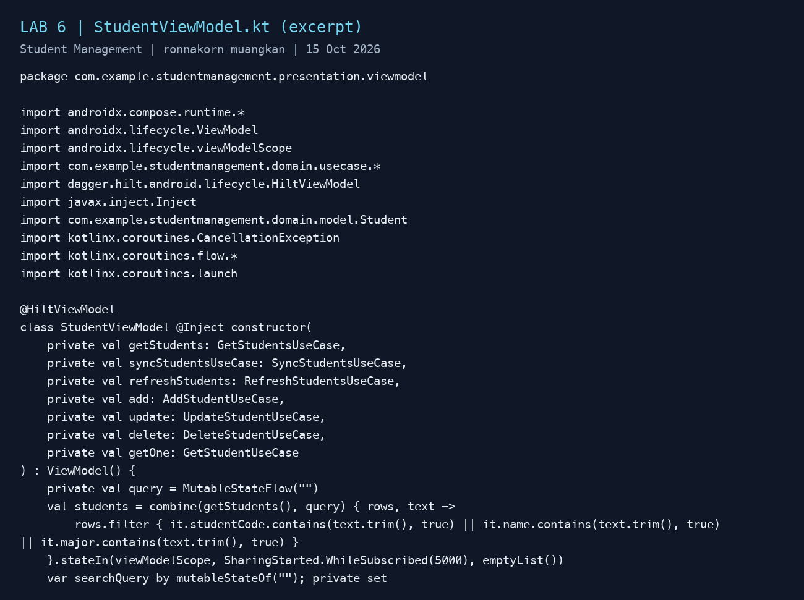

# LAB 6 — Hilt Dependency Injection

ผู้จัดทำ: **ronnakorn muangkan**  
วันที่ทดสอบ: 15 ตุลาคม 2026

## 1. ภาพโครงสร้าง di/

| Module | Dependency ที่จัดเตรียม |
| --- | --- |
| DatabaseModule | AppDatabase และ StudentDao โดยใช้ฐานข้อมูลเดิมและ migration เดิม |
| NetworkModule | TokenStorage, Retrofit, StudentApi และ AuthApi |
| RepositoryModule | ผูก StudentRepository interface กับ StudentRepositoryImpl ด้วย @Binds |
| UseCaseModule | สร้าง Use Case ทั้ง 7 ตัวด้วย @Provides |

Database, Retrofit, TokenStorage และ Repository เป็น @Singleton ใน SingletonComponent จึงใช้ instance ร่วมกันภายใน process โดย Repository ของ ViewModel กับ Worker ใช้ Mutex ตัวเดียวกันในการป้องกัน Sync ซ้อน

## 2. ภาพ @HiltAndroidApp

StudentApplication มี @HiltAndroidApp และกำหนด android:name ใน Manifest ให้ตรงกัน MainActivity มี @AndroidEntryPoint เพื่อรับ dependency จาก Hilt

Application ยังเป็น Configuration.Provider สำหรับ WorkManager โดยรับ HiltWorkerFactory แล้วกำหนดผ่าน setWorkerFactory() และเอา default WorkManager initializer ออกผ่าน manifest merger เพื่อให้ WorkManager ใช้ factory ที่สร้าง @HiltWorker ได้

## 3. ภาพ @HiltViewModel

StudentViewModel มี @HiltViewModel และ @Inject constructor รับ Use Case ของ Domain หน้าจอเรียก hiltViewModel() แทนการสร้าง StudentViewModelFactory เอง ส่วน LoginViewModel ใช้ Hilt เช่นกัน โดยรับ AuthApi และ TokenStorage

ภาพโครงสร้างและโค้ดทั้งสามเป็นภาพจัดรูปแบบจากไฟล์ source จริงของงานส่ง ไม่ใช่ภาพหน้าต่าง IDE โค้ดเต็มอยู่ใน ZIP และตรวจเทียบได้จาก StudentApplication.kt, presentation/viewmodel/StudentViewModel.kt และ di/

## 4. Hilt ช่วยลดการสร้าง Object แบบ Manual อย่างไร

เดิม MainActivity หรือ AppContainer ต้องสร้าง Database → DAO → Retrofit → API → Repository → ViewModel ตามลำดับเอง และต้องเขียน Factory เพื่อส่ง dependency เข้า ViewModel เมื่อ dependency เปลี่ยนก็ต้องตามแก้จุดประกอบ object เหล่านี้

Hilt ให้เราประกาศสิ่งที่แต่ละคลาสต้องใช้ผ่าน constructor แล้วสร้างโค้ดเชื่อม dependency ให้ตอน build ใช้ @Provides สำหรับ object ที่ต้องสร้างด้วย builder หรือ factory เช่น Room/Retrofit และ @Binds ระบุ implementation ของ interface เมื่อหน้าจอขอ StudentViewModel ระบบจึงส่ง Use Case และ Repository ที่ประกอบไว้ให้ โดยไม่ต้องเขียนลำดับการสร้างซ้ำในหน้าจอ

Hilt ไม่ได้ทำให้ไม่มีการสร้าง object เลย แต่รวมวิธีสร้างไว้ใน module และจัดการ scope/lifecycle ให้ เช่น @Singleton ทำให้แชร์ dependency ได้ ส่วน Unit Test สามารถส่ง FakeRepository เข้า Use Case ได้โดยตรงโดยไม่เปิด Android หรือ Hilt container หลักการ annotation และการสร้าง dependency อ้างอิง [Android Developers: Hilt](https://developer.android.com/training/dependency-injection/hilt-android)

Domain ในงานนี้ใช้ constructor ธรรมดา และให้ UseCaseModule เป็นผู้ provide เพื่อไม่ให้ Domain ต้องรู้จัก Hilt

## 5. ผลตรวจสอบ

- assembleDebug ผ่าน รวมขั้นตอน KSP และ Hilt code generation
- ติดตั้งทับแอปเดิมแล้ว Login สำเร็จและอ่านข้อมูล Room เดิมได้
- StudentViewModel ที่รับผ่าน Hilt แสดงรายการและเพิ่มข้อมูล Offline ได้
- HiltWorkerFactory สร้าง SyncWorker สำเร็จจริง: Logcat มี SUCCESS synced=1 และ PostgreSQL มีแถวที่ส่ง
- ไม่มี StudentViewModelFactory และ AppContainer แบบ Manual ในรุ่นรวม Lab 3–7

ดูหลักฐานการทำงานจริงร่วมกับ LAB5_Report.md และผล Unit Test 13 รายการใน LAB7_Report.md

อ้างอิงการใช้ร่วมกับ ViewModel/WorkManager: [Android Developers: Hilt with Jetpack](https://developer.android.com/training/dependency-injection/hilt-jetpack)
