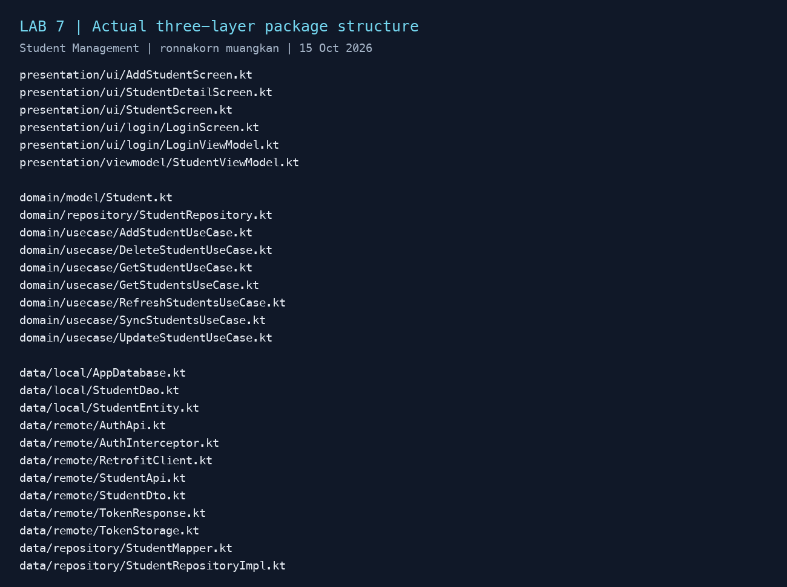
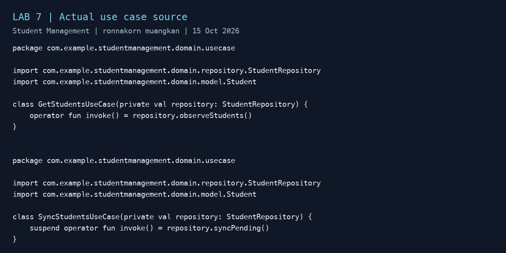
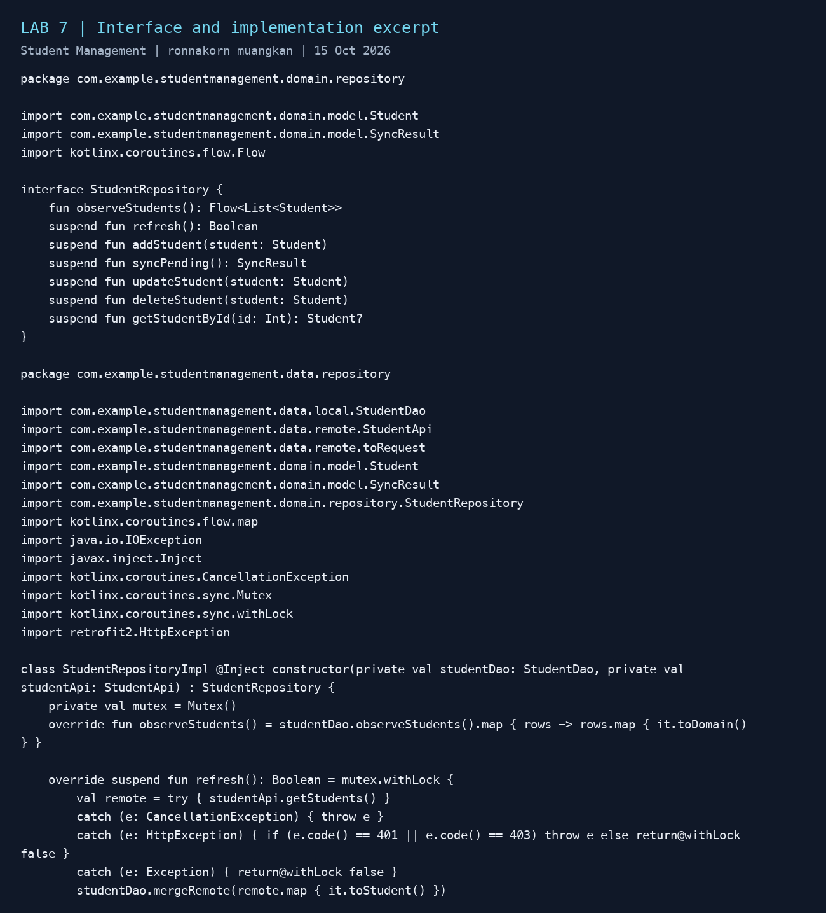
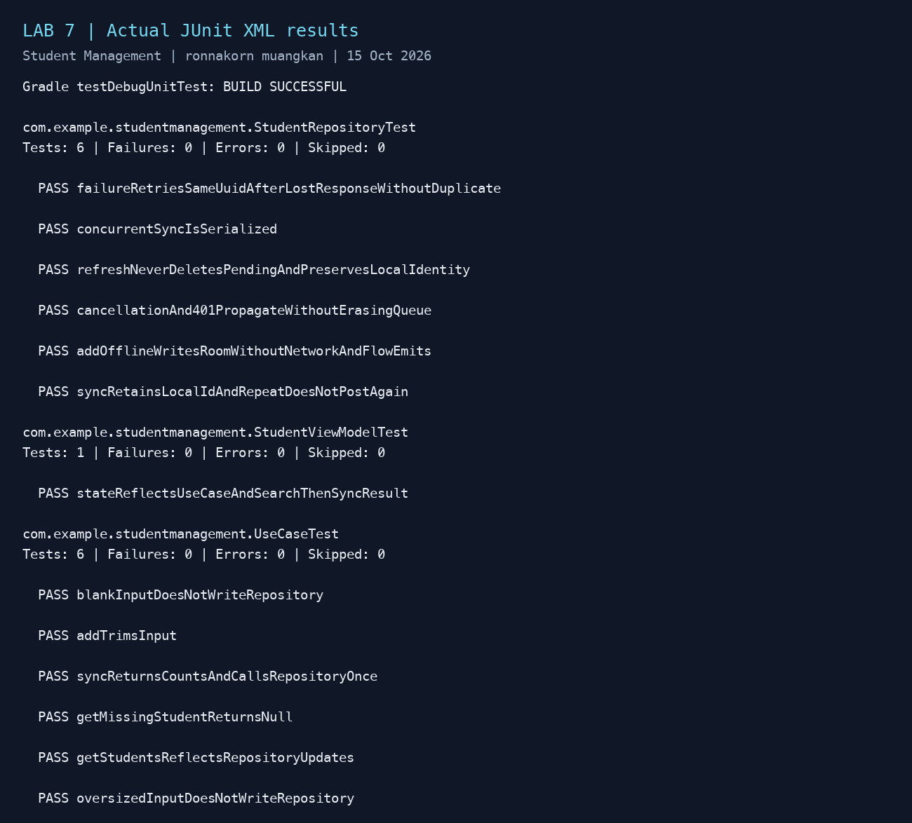

# LAB 7 — Clean Architecture + Unit Testing

ผู้จัดทำ: **ronnakorn muangkan**  
วันที่ทดสอบ: 15 ตุลาคม 2026

## 1. ภาพโครงสร้าง Package ทั้ง 3 ชั้น



| ชั้น | หน้าที่ในโปรเจกต์ |
| --- | --- |
| Presentation | Compose screens และ ViewModel รับคำสั่งผู้ใช้และแสดง StateFlow |
| Domain | Student model, Use Case และ StudentRepository interface เป็นสัญญาของงาน |
| Data | StudentRepositoryImpl, Room Entity/DAO, Retrofit API/DTO และ mapper |

```text
StudentScreen → StudentViewModel → Use Case → StudentRepository (Domain)
                                                   ↑ implements
                                        StudentRepositoryImpl (Data)
                                             ↙              ↘
                                           Room           Retrofit → FastAPI → PostgreSQL

WorkManager → SyncWorker → SyncStudentsUseCase → StudentRepository
```

ภาพ package และโค้ดในรายงานนี้จัดรูปแบบจากไฟล์จริงเพื่อให้อ่านง่าย ไม่ใช่ภาพหน้าต่าง IDE โครงสร้างของแอปอยู่ภายใต้ app/src/main/java/com/example/studentmanagement/

## 2. ไฟล์ Use Case อย่างน้อย 2 ไฟล์



แนบไฟล์ .kt จริงใน ZIP รายงานไว้ใน source/ โดยคงโครงสร้างเดิม:

- domain/usecase/GetStudentsUseCase.kt คืน Flow ของรายการจาก Repository
- domain/usecase/SyncStudentsUseCase.kt เรียก Sync และคืนจำนวนสำเร็จ/ล้มเหลว/ลองใหม่ได้
- domain/usecase/AddStudentUseCase.kt ตรวจข้อมูลว่างและความยาว พร้อม trim ก่อนบันทึก
- ยังมี GetStudentUseCase, RefreshStudentsUseCase, UpdateStudentUseCase และ DeleteStudentUseCase ในชุดโค้ดรวม

Use Case ทั้งหมดอ้างถึง interface ของ Domain ไม่เรียก DAO หรือ API โดยตรง

## 3. Repository Interface และ Implementation



แนบไฟล์จริง source/domain/repository/StudentRepository.kt และ source/data/repository/StudentRepositoryImpl.kt รวมทั้ง StudentMapper.kt ใน ZIP รายงาน

Interface ระบุความสามารถ เช่น observeStudents(), addStudent(), syncPending() ส่วน implementation จัดการ Room และ Retrofit จริง: เพิ่มลง Room เป็น PENDING, ส่งข้อมูลพร้อม client_id, บันทึก serverId เมื่อสำเร็จ, คงแถว FAILED เพื่อลองใหม่ และใช้ Mutex ป้องกันงานชนกัน

StudentEntity เป็นโมเดลฐานข้อมูลที่มี @Entity ส่วน StudentDto เป็นโมเดลเครือข่าย ฝั่ง Data แปลงเป็น domain.model.Student ก่อนคืนให้ Domain/Presentation Local ID คงเดิมหลัง Sync ไม่เปลี่ยนไปใช้ Server ID จึงรักษาตัวตนของแถวใน UI

RepositoryModule ใช้ @Binds ผูก interface กับ implementation; UseCaseModule สร้าง Use Case ผ่าน @Provides ส่วน StudentViewModel รับ Use Case ผ่าน @HiltViewModel

## 4. ผล Unit Test



คำสั่งที่ใช้: `./gradlew testDebugUnitTest` ด้วย JDK 17 — **13 tests ผ่าน, 0 failures, 0 errors, 0 skipped** และ `./gradlew assembleDebug` ผ่าน

| ชุดทดสอบ | จำนวน | สิ่งที่ตรวจ |
| --- | ---: | --- |
| StudentRepositoryTest | 6 | บันทึกโดยไม่เรียก API, Flow/mapping, Local ID คงเดิม, retry UUID เดิมเมื่อคำตอบสูญหาย, Refresh ไม่ทิ้งคิว, cancellation/401 และ Sync พร้อมกัน |
| UseCaseTest | 6 | อ่าน Flow, Sync เรียก repository ครั้งเดียวและคืนผล, trim, ปฏิเสธช่องว่าง/ความยาวเกินก่อนเขียน, ไม่พบ ID คืน null |
| StudentViewModelTest | 1 | State มาจาก Use Case, ค้นรายการ, สถานะผล Sync, ไม่ค้าง loading และไม่มี error |

หลักฐานต้นฉบับ: [unit-test-results.txt](evidence/lab7/unit-test-results.txt), [gradle-test.log](evidence/lab7/gradle-test.log) และไฟล์ TEST-*.xml ใน evidence/lab7/ พร้อมโค้ด test ใน source/tests/

Unit Test ใช้ fake DAO/API หรือ FakeRepository และ coroutine test dispatcher จึงตรวจ business behavior ได้โดยไม่ต้องเปิด PostgreSQL/Emulator ส่วนการใช้งาน Room, Hilt และ WorkManager จริงตรวจแยกบน Emulator ตามหลักฐาน Lab 5 ไม่อ้างว่า JVM tests เป็นการทดสอบฐานข้อมูลจริง

## 5. ทำไม Domain ไม่ควรขึ้นกับ Room หรือ Retrofit โดยตรง

Domain ควรบอกว่าแอปทำอะไร เช่น เพิ่มนักศึกษาและ Sync ข้อมูล โดยไม่ผูกกับวิธีจัดเก็บหรือรับส่ง หาก Use Case เรียก Room DAO หรือ Retrofit API โดยตรง กฎธุรกิจจะขึ้นกับ schema, annotation, HTTP response และรายละเอียดของไลบรารี ทำให้เปลี่ยนเทคโนโลยีหรือทดสอบแยกได้ยาก

การกำหนด Repository interface ใน Domain ทำให้ Data เป็นฝ่าย implement สัญญาที่ Domain ต้องการ เราสามารถเปลี่ยนจาก Room เป็นฐานข้อมูลอื่น หรือเปลี่ยน Retrofit โดยแก้ Data และ mapper เป็นหลัก ขณะที่ Use Case ยังทำงานด้วย Student model เดิมได้ การทดสอบก็ส่ง FakeRepository ที่อยู่ในหน่วยความจำแทนของจริง จึงเร็วและควบคุมกรณีสำเร็จ/ผิดพลาดได้

ในงานนี้ domain/ ไม่มี import Android, Room, Retrofit, Data implementation หรือ Hilt มีเพียง Kotlin และ kotlinx.coroutines.flow สำหรับสัญญาข้อมูลแบบต่อเนื่อง การแบ่งชั้นเป็น package ภายใน Gradle app module เดียว ยังไม่ได้แยกเป็น Gradle modules เพื่อบังคับ dependency ด้วย build system

## 6. การรวม Lab 3–7 และวิธีรัน

1. Login → AuthApi → FastAPI ตรวจ credentials → ได้ JWT และบันทึก Token
2. เพิ่มขณะ Offline → ViewModel → AddStudentUseCase → Repository → Room PENDING
3. กด Background Sync → WorkManager รอ Network → Worker → SyncStudentsUseCase → Repository → Retrofit แนบ JWT → PostgreSQL → Room SYNCED
4. Logout → ลบ Token, ยกเลิกงาน Sync และกลับหน้า Login; Backend ยังคงปฏิเสธ request ที่ไม่มี Token หรือ Token ไม่ถูกต้อง

เปิด StudentManagement ใน Android Studio ใช้ JDK 17 และ SDK 34 รัน Backend ตาม student-api/README.md ด้วย Docker Compose แล้ว Login บัญชีสาธิต ronnakorn / Lab3pass123! Android Emulator ติดต่อ http://10.0.2.2:8000/ ชุด ZIP รวมมี Android source, Backend, APK และ SQL backup สำหรับนำข้อมูลไปเปิดเครื่องอื่น

ขอบเขต: คิว Offline/Background Sync ใช้กับการเพิ่มข้อมูลตาม Lab 4; แก้ไข/ลบรายการที่ Sync แล้วใช้เครือข่าย ระบบเป็นบัญชีสาธิตเดียว ยังไม่มีการแยกข้อมูลหลายผู้ใช้หรือแก้ conflict หลายอุปกรณ์
