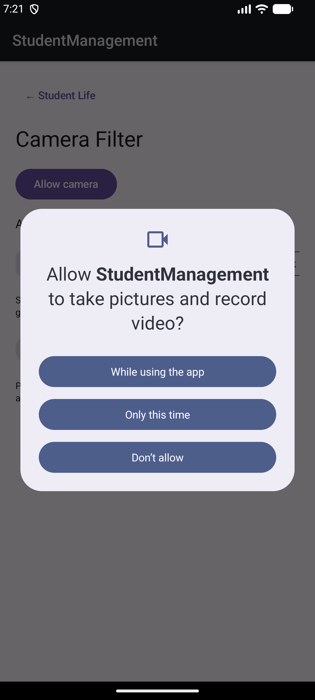
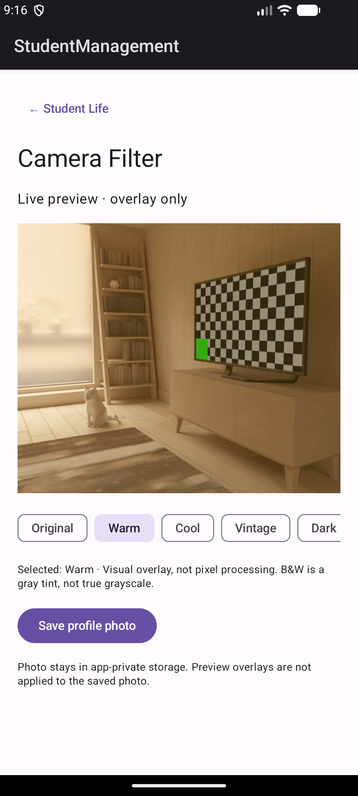
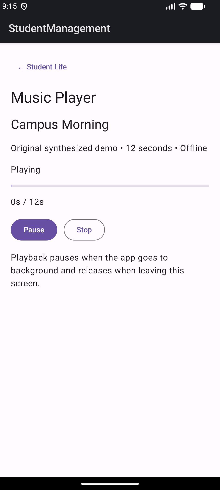
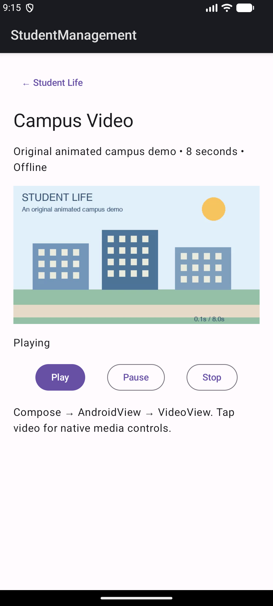
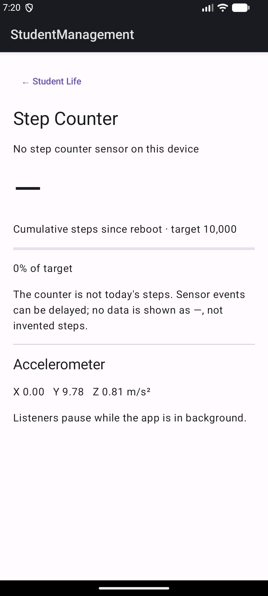

# LAB 8 — Multimedia and Sensors

ผู้จัดทำ: **ronnakorn muangkan**  
โปรเจกต์: Student Life ต่อจาก StudentManagement Lab 3–7  
วันที่ทดสอบ: 15 ตุลาคม 2026

## 1. ภาพรวมและโครงสร้าง

พัฒนาในโปรเจกต์เดิมโดยเพิ่ม HomeScreen และเส้นทาง Camera, Music, Video, Sensor หลัง Login หน้าจัดการนักศึกษาเดิมยังเข้าผ่านปุ่ม Student Management ได้ ทั้ง JWT, Room, Hilt และ WorkManager ยังคงอยู่

```text
presentation/ui/
  home/HomeScreen.kt
  camera/CameraScreen.kt
  music/MusicScreen.kt
  video/VideoScreen.kt
  sensor/StepCounterScreen.kt
  animation/LoadingAnimation.kt
  life/LifeLayout.kt
sensor/StepCounterManager.kt
domain/model/StepProgress.kt
res/raw/
  music.mp3
  campus.mp4
  loading.json
  walking.json
```


## 2. CameraX และ Visual Overlay Filter

CameraScreen ใช้ AndroidView เพื่อใส่ PreviewView ใน Compose แล้ว bind Preview และ ImageCapture เข้ากับ lifecycle ด้วย CameraX ขอ CAMERA แบบ runtime ก่อนเปิดกล้อง หากปฏิเสธจะแสดงคำแนะนำและปุ่มลองใหม่ ส่วนอุปกรณ์ที่ไม่มีกล้องจะรายงานข้อผิดพลาดแทนการทำให้แอปปิด





มี Original, Warm, Cool, Vintage, Dark และ B&W โดยใช้สีโปร่งใสซ้อนบน Preview ตามใบงาน **เป็น Visual Overlay ไม่ใช่การประมวลผล pixel** และ B&W เป็นการซ้อนสีเทา ไม่ใช่ grayscale จริง ปุ่ม Save profile photo บันทึกภาพต้นฉบับลง app-private storage ไม่ต้องขอสิทธิ์พื้นที่จัดเก็บ และไม่ได้ฝัง overlay ลงในไฟล์ภาพ

เมื่อออกจากหน้าจอจะ unbind use cases ที่หน้าจอนี้สร้าง กล้องถูกผูกกับ lifecycle จึงไม่ทำงานต่อเมื่อ activity หยุด

## 3. Music Player



ใช้ MediaPlayer.create(context, R.raw.music) เล่นเพลง Campus Morning ความยาวประมาณ 12 วินาที ซึ่งเป็นเสียงสังเคราะห์ที่สร้างสำหรับงานนี้ มี Play/Pause และ Stop โดย Stop ใช้ pause() + seekTo(0) จึงเริ่มเล่นใหม่ได้โดยไม่ต้อง prepare ซ้ำ แสดงตำแหน่งและ progress ขณะเล่น เมื่อเพลงจบเปลี่ยนสถานะกลับ พร้อมเริ่มใหม่

ใช้ LifecycleEventObserver เพื่อ Pause เมื่อแอปเข้า background และ DisposableEffect เพื่อ release() เมื่อออกจากหน้าจอ ไม่สร้าง MediaPlayer ใหม่ทุก recompose

## 4. VideoView ผ่าน AndroidView



ใช้ VideoView กับไฟล์ res/raw/campus.mp4 ผ่าน URI android.resource:// และมี MediaController พร้อมปุ่ม Play/Pause/Stop ใน Compose วิดีโอเป็นภาพเคลื่อนไหวมหาวิทยาลัยที่สร้างขึ้นเองยาว 8 วินาที ไม่ใช่ภาพถ่ายสถานที่จริง เล่นได้โดยไม่ต้องต่ออินเทอร์เน็ต

AndroidView เป็นสะพานให้ Compose ใช้ Android View เดิมได้ ขั้นตอนคือ Compose → AndroidView → VideoView → ไฟล์วิดีโอ ตั้งแหล่งวิดีโอใน factory เพียงครั้งเดียว ไม่ reset ทุก recompose; pause เมื่อเข้า background และ stopPlayback เมื่อออกจากหน้าจอ

## 5. Step Counter และ Accelerometer



StepCounterManager อ่าน TYPE_STEP_COUNTER และตรวจ ACTIVITY_RECOGNITION บน Android 10 ขึ้นไปก่อน register listener หากไม่มีสิทธิ์และมีเซนเซอร์ หน้าจอมีปุ่มขอ runtime permission

ค่าจาก Step Counter เป็นก้าวสะสมตั้งแต่ reboot ในช่วงที่เซนเซอร์ทำงาน ไม่ใช่ก้าวของวันนี้ จึงใช้ป้าย “Cumulative steps since reboot” และไม่ได้เรียกตัวเลขนั้นว่า Today's Steps เป้าหมาย 10,000 ก้าว คำนวณ progress = (steps / 10000f).coerceIn(0f, 1f) เมื่อยังไม่มี event แสดง — แทนการสร้างข้อมูลเอง

Emulator ที่ใช้ทดสอบไม่มี TYPE_STEP_COUNTER จึงตรวจได้จริงเฉพาะกรณีไม่รองรับและค่า TYPE_ACCELEROMETER แกน X/Y/Z การเดินเพิ่มก้าวจริงและ permission ของ Step Counter ยังต้องทดสอบบนโทรศัพท์ที่มี sensor นี้ ค่า Accelerometer บน Emulator เป็นข้อมูลจาก virtual sensor ไม่ใช่การวัดการเดินจริง

Listener ถูก unregister เมื่อ Activity pause และลงทะเบียนใหม่เมื่อ resume จึงไม่เปิดเซนเซอร์ค้างใน background

อ้างอิงพฤติกรรมเซนเซอร์และสิทธิ์: [Android Developers: Motion sensors](https://developer.android.com/develop/sensors-and-location/sensors/sensors_motion)

## 6. สื่อและวิธีรัน

MP3, MP4 และ Lottie JSON เป็นสื่อที่สร้างขึ้นสำหรับงานนี้ มี MEDIA_LICENSE.txt และ tools/generate_lab89_media.py สำหรับตรวจสอบที่มา ไม่ต้องดาวน์โหลดสื่อเพิ่มระหว่างรันแอป

เปิดโปรเจกต์ด้วย Android Studio, JDK 17, SDK 34 รัน Backend ตาม student-api/README.md แล้ว Login ด้วยบัญชีสาธิต ronnakorn / Lab3pass123! จากนั้นเลือกฟีเจอร์ใน Student Life การเล่นสื่อและ sensor ไม่ต้องเรียก Backend หลังเข้าหน้า Home แล้ว

CameraX ทั้งสาม dependency ใช้เวอร์ชัน 1.4.2 เท่ากันเพื่อเข้ากับ toolchain เดิม ดู [CameraX release notes](https://developer.android.com/jetpack/androidx/releases/camera)

## ผลตรวจสอบจริง

Build และ Unit Test ผ่าน 15 รายการ กล้อง Emulator แสดงฉากจำลองได้ ปฏิเสธสิทธิ์แล้วกลับมาขอใหม่ได้ Warm overlay แสดงถูกต้อง และพบไฟล์ profile JPEG ใน app-private storage หลังสั่งบันทึก Music และ Video แสดงสถานะ Playing บนหน้าจอ ไม่ได้ทดสอบการเดินเพิ่มค่าก้าวจริงเพราะ Emulator ไม่มี Step Counter
