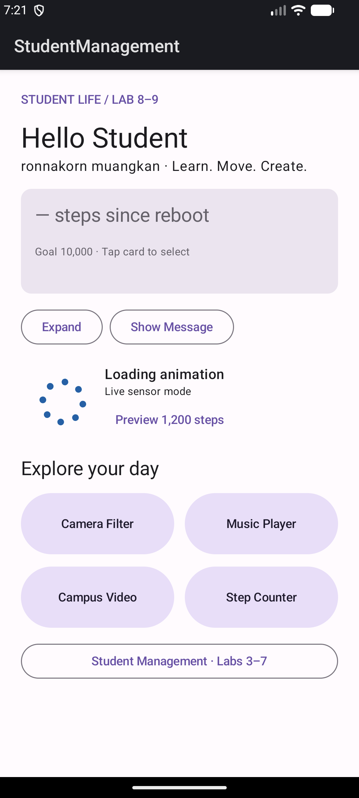
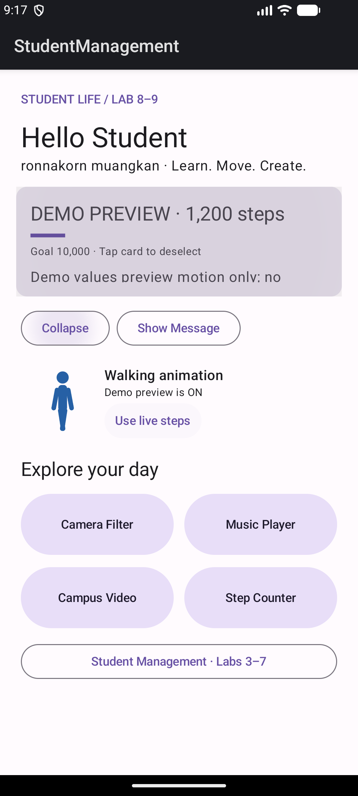
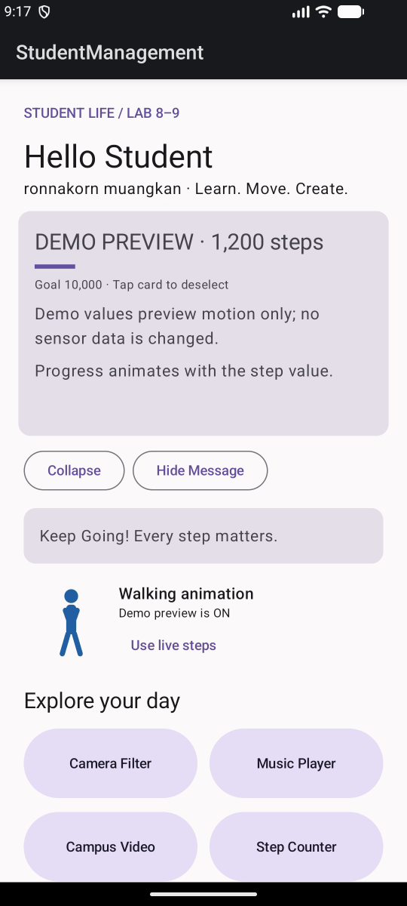

# LAB 9 — Animation and Motion

ผู้จัดทำ: **ronnakorn muangkan**  
โปรเจกต์: Animated Student Life Dashboard ต่อจาก Lab 8  
วันที่ทดสอบ: 15 ตุลาคม 2026

## 1. Dashboard และแนวคิด Motion

ใช้ HomeScreen เดียวกับ Lab 8 เพิ่ม motion เพื่อช่วยให้เห็นการเปลี่ยน state ได้แก่ header เข้าหน้า, card ขยาย, progress เปลี่ยน, card ถูกเลือก, ข้อความแสดง/ซ่อน และการเปลี่ยนหน้า มี Animation ครบ 5 ประเภทตามใบงาน

## 2. Property Animation — animateDpAsState / animateFloatAsState

ปุ่ม Expand/Collapse เปลี่ยน expanded โดย animateDpAsState เปลี่ยนความสูงจาก 120.dp เป็น 220.dp ด้วย tween 500 ms ส่วน progress bar ใช้ animateFloatAsState กับค่า steps / 10000f ที่จำกัดให้อยู่ระหว่าง 0–1 ด้วย tween 800 ms

Compose คำนวณค่าระหว่างสถานะให้โดยไม่ต้องเขียน loop เพิ่มความสูงทีละ pixel ค่าเป้าหมายเปลี่ยนแล้ว UI ค่อย ๆ ไปถึงสถานะใหม่

## 3. AnimatedVisibility — Fade และ Slide

Header “Hello Student” ใช้ fadeIn + slideInVertically เมื่อเข้าหน้า Home ส่วน Feature Cards ทั้ง 4 แสดงด้วย AnimatedVisibility และเลื่อนเวลาเริ่มแต่ละแถวเล็กน้อย

ปุ่ม Show Message/Hide Message เปิดและปิดข้อความ Keep Going! ใช้ enter = fadeIn + slideInVertically และ exit = fadeOut + slideOutVertically จึงเห็นทั้งการปรากฏและหาย ไม่ใช่แค่เปลี่ยน visibility ทันที

## 4. Transition — หลาย property ใช้ state เดียว

Step Card ใช้ updateTransition(targetState = selected) เมื่อแตะ card จะเปลี่ยน scale 1.0 → 1.03 และ alpha 0.85 → 1.0 พร้อมกันผ่าน graphicsLayer เมื่อแตะอีกครั้งจะกลับค่าเดิม

Transition เหมาะกับการเปลี่ยนหลาย property ให้สัมพันธ์กับ state เดียว ส่วน animate*AsState เหมาะกับ property เดี่ยวที่มีเป้าหมายชัดเจน

## 5. Lottie Animation

LoadingAnimation.kt ใช้ rememberLottieComposition และ animateLottieCompositionAsState วนด้วย LottieConstants.IterateForever โดยอ่านไฟล์ loading.json และ walking.json จาก res/raw ไม่ต้องใช้อินเทอร์เน็ต ไฟล์ทั้งสองสร้างจาก vector shapes สำหรับโปรเจกต์นี้

- steps < 1,000: แสดง loading animation
- steps ≥ 1,000: แสดง walking animation
- เมื่อหน้า Home ไม่อยู่ในสถานะ STARTED animation จะหยุดเล่น
- หากอ่าน animation ไม่ได้มีข้อความ Animation unavailable

Emulator ไม่มี Step Counter จึงมีปุ่ม **Preview 1,200 steps** สำหรับตรวจ progress และการสลับ Lottie เท่านั้น บน UI ระบุ **DEMO PREVIEW** ชัดเจน ตัวเลขนี้ไม่ถูกเขียนกลับ sensor หรือฐานข้อมูล ปุ่ม Use live steps กลับไปแสดงข้อมูลจริงที่มีอยู่ ขณะยังไม่มี sensor event แสดง —

Lottie ใช้ dependency lottie-compose 6.4.1 ที่เข้ากับ Compose/Kotlin ของโปรเจกต์เดิม ไม่ได้อ้างว่าเป็นเวอร์ชันล่าสุด ดู [Lottie Android](https://github.com/airbnb/lottie-android)

## 6. Screen Transition

กำหนด enterTransition และ exitTransition ของแต่ละ destination ใน Navigation Compose 2.7.7:

| หน้าจอ | Animation |
| --- | --- |
| Camera | Slide แนวนอน 450 ms |
| Music | Fade 450 ms |
| Video | Scale 0.85 → 1.0 พร้อม Fade |
| Sensor | Slide แนวนอน 450 ms |

ใช้ Navigation Compose ที่มีอยู่ในโปรเจกต์เดิม ไม่สร้าง Activity ใหม่สำหรับแต่ละฟีเจอร์ Back กลับมาหน้า Student Life ได้ และหน้า Student Management ยังคงอยู่ใน graph เดียวกัน

## 7. หลักฐานภาพเคลื่อนไหวและผลตรวจ

ภาพ Demo walking ดึงจากเฟรมของคลิป Emulator จริง ภาพนิ่งแสดงสถานะต้น/ปลาย แต่ไม่สามารถพิสูจน์ motion ได้ครบ จึงแนบ [วิดีโอการใช้งานจริงจาก Emulator](evidence/lab9/dashboard-motion.mp4) เพื่อดูการขยาย card, AnimatedVisibility, การเปลี่ยน progress/Lottie โดยค่า 1,200 ในคลิปเป็น Demo ที่ระบุบนจอ

รัน `./gradlew assembleDebug testDebugUnitTest` และแนบผลจริงใน evidence/lab9/gradle-build.log กับ JUnit XML ทั้งหมด รวม tests เดิมของ Lab 7 และ tests ใหม่ที่ตรวจการจำกัด progress/threshold ของ animation

ขอบเขต: UI แบ่ง layer ตามโปรเจกต์เดิม ส่วน camera/media/sensor เป็น Android platform adapters ใน presentation/sensor layer ไม่ย้าย Android API เข้า Domain แบบจำลอง StepProgress ใน Domain เป็น pure Kotlin จึงทดสอบได้บน JVM

ผลล่าสุด: **15 tests ผ่าน, 0 failures, 0 errors** รวม 13 tests เดิมและ StepProgressTest 2 tests
